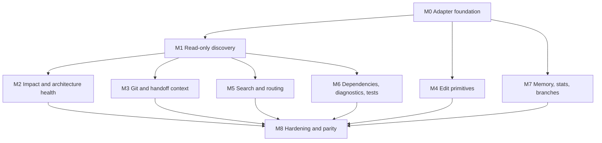

# TokenSave integration analysis

- **Role**: architect v2
- **Date**: 2026-09-15
- **Status**: analysis, with a plan
- **Scope**: `rule-mcp` (this repository) against the TokenSave MCP server `v7.12.1`
- **Sources**:
  - Repository: <https://github.com/aovestdipaperino/tokensave>
  - Site: <https://tokensave.dev>
  - Local CLI: `tokensave --help`, `tokensave tool`, `tokensave status`, `tokensave gain`, `tokensave doctor`
  - MCP surface in this instance: 89 tools (`tokensave_tokensave_*` + `tokensave_read_*`)

This document classifies every TokenSave tool, records how it is used and parameterized, and
builds a prioritised plan to replace JavaScript work in this server wherever TokenSave already
does the same thing — keeping the JavaScript as the fallback and the source of truth when the
graph is unavailable.

The deliverable lives at `docs/audit/tokensave-integration.md`, as requested. It is deliberately
not under `docs/audits/`, because that directory is reserved for persona audit/review/plan
trios and every file there must declare a `Role: <persona> v<version>` header.

## 1. Executive summary

TokenSave is a local, Rust-based code-graph MCP server. It indexes a project into a persistent
libSQL database (`.tokensave/tokensave.db`) and answers semantic questions — symbols,
relationships, call graphs, impact, health, tests, git history — without reading source files on
every request. It advertises 80+ tools, 50+ languages and 100% local operation. This project
already ships `.tokensave/` (1,671 files, 13,224 nodes, 5,634 edges, 35.9 MB — measured with
`tokensave status` on 2026-09-15, branch `develop`).

Today `rule-mcp` uses TokenSave only as a _suppression signal_: `src/core/agents/_integrations.js`
detects a `.tokensave/` directory and trims its own context dumps, assuming the agent will query
the graph itself. Everything else — file traversal, symbol lookup, call-graph walks, guardrail
static analysis, git/handoff context, edit primitives, token accounting — is reimplemented in
JavaScript inside this server.

The opportunity is larger than suppression. Most of those JavaScript implementations are exactly
what TokenSave exposes as bounded, indexed, deterministic tools. Replacing them with a thin
adapter that prefers TokenSave and falls back to the current JavaScript would:

- cut the code that this server has to maintain and ship (the largest core modules are
  `telemetry` 38 files, `text` 37, `agents` 25, `review` 23, `session` 15, `cache` 15,
  `guardrails` 14);
- make the expensive answers (call graphs, impact, health, test coverage, dependency depth)
  indexed queries instead of ad-hoc scans;
- keep the deterministic, local-first contract, because TokenSave is also deterministic and
  local;
- compound the token savings the server already reports: TokenSave reports 97.6k tokens saved
  over 85 calls in the last 30 days on this project alone (`tokensave gain`), before any of the
  integration below.

The plan below is staged so every step is reversible: the adapter always keeps the JavaScript
path green, and the JS path is the one tested when `.tokensave/` is missing.

## 2. TokenSave overview

### 2.1 What it is

TokenSave indexes a project with tree-sitter extractors into a code graph:

- **Nodes**: files, functions, methods, classes, structs, enums, traits, interfaces, impls,
  fields, modules, consts, tests, annotations, imports.
- **Edges**: `calls`, `implements`, `extends`, `uses`, `contains`, `annotates`,
  `derives_macro`, and dependency/import edges.
- **Search**: FTS5 over symbol names and docstrings.
- **Queries**: a rich MCP surface (89 tools) plus a CLI (`tokensave tool <name>`) and resources
  (`tokensave_read_*`).
- **Storage**: one libSQL DB per project under `.tokensave/`, with optional per-branch DBs.
- **Freshness**: on-demand staleness check with a 30 s cooldown, catch-up sync on connect, and
  an incremental `tokensave sync`.
- **Isolation**: extraction runs in subprocesses, so a grammar crash kills a worker, not the
  index.

### 2.2 Language and tier coverage

The README advertises 50+ languages across three build tiers (`lite`, `medium`, `full`); this
project is indexed as JavaScript (1,170 files), Bash (6), TypeScript (2), PowerShell (2), SQL (1),
plus artifacts (490). The languages that matter to this repo — JavaScript (ESM), TypeScript,
Markdown, JSON/YAML/TOML, SQL — are all covered. Rust-specific tools (`derives`, `impls`,
`diagnose`, `run_affected_tests`) are useful only if the repository is re-implemented in Rust;
they are listed for completeness but deprioritised.

### 2.3 The CLI surface that matters here

| Command                                       | Purpose                                                                  | Use in the plan                                            |
| --------------------------------------------- | ------------------------------------------------------------------------ | ---------------------------------------------------------- |
| `tokensave tool`                              | List tools; `tokensave tool <name> --help` shows parameters.             | Discovery and contract tests.                              |
| `tokensave status`                            | Graph statistics (files, nodes, edges, DB size).                         | Health probe in the adapter.                               |
| `tokensave gain`                              | Token savings and dollar estimates from the global ledger.               | Replacement for part of `rule_tool_stats`/`rule_tool_usage`. |
| `tokensave cost`                              | Token cost summary from local agent sessions.                            | Same.                                                      |
| `tokensave discover`                          | Finds navigation turns a TokenSave query could have served more cheaply. | Regression metric for the migration.                       |
| `tokensave doctor`                            | Installation, configuration, agent integration checks.                   | Preflight in `rule-mcp doctor`.                      |
| `tokensave sync`                              | Incremental re-index.                                                    | Adapter freshness control.                                 |
| `tokensave current-counter` / `reset-counter` | Project-local token counter.                                             | Optional counter ownership.                                |

### 2.4 How the MCP surface is exposed

Two families exist:

- `tokensave_tokensave_*` — the 84 callable tools.
- `tokensave_read_*` — the 5 resource tools (`read_graph_status`, `read_file_list`,
  `read_project_overview`, `read_tracked_branches`, `read_sqlite_schema`).

Two parameters recur on almost every read tool and must be part of the adapter contract:

- `graph_root` — absolute project root to query; accepts an array on `search` and `files` to
  answer across projects.
- `graph_branch` — tracked branch to query within `graph_root`.

## 3. TokenSave tool catalog (89 tools)

Classification follows the CLI's own groups, plus the resource family. "Key params" lists the
parameters that change behaviour; unlisted parameters are optional conveniences.

### 3.1 Analysis — 17 tools

| Tool                | Purpose                                                            | Key params                                               |
| ------------------- | ------------------------------------------------------------------ | -------------------------------------------------------- |
| `circular`          | Detect circular file dependencies.                                 | `max_depth`                                              |
| `complexity`        | Rank functions by composite complexity (lines + fan-out + fan-in). | `node_kind`, `path`, `limit`                             |
| `constructors`      | Every literal instantiation of a struct, with missing fields.      | `struct`, `limit`                                        |
| `coupling`          | Rank files by `fan_in` or `fan_out`.                               | `direction`, `path`, `limit`                             |
| `dead_code`         | Symbols with no incoming edges.                                    | `kinds`, `include_public`, `include_trait_impls`, `path` |
| `distribution`      | Node-kind distribution per file or directory.                      | `path`, `summary`                                        |
| `doc_coverage`      | Public symbols missing docstrings.                                 | `path`, `limit`                                          |
| `field_sites`       | Every read and write site of a named field.                        | `field`, `writes_only`, `limit`                          |
| `god_class`         | Classes with the most members.                                     | `path`, `limit`                                          |
| `hotspots`          | Symbols with the highest connectivity.                             | `limit`, `path`                                          |
| `inheritance_depth` | Deepest inheritance hierarchies.                                   | `path`, `limit`                                          |
| `largest`           | Rank nodes by line count.                                          | `node_kind`, `path`, `limit`                             |
| `module_api`        | Public API surface of a file or directory.                         | `path`                                                   |
| `rank`              | Rank nodes by edge count for one relationship.                     | `edge_kind`, `direction`, `node_kind`, `limit`           |
| `recursion`         | Recursive and mutually-recursive call cycles.                      | `path`, `limit`                                          |
| `unsafe_patterns`   | `unwrap`/`expect`/`panic`/`todo`/`unsafe` sites.                   | `kinds`, `path`, `exclude_tests`, `limit`                |
| `unused_imports`    | Imports never referenced.                                          | `path`                                                   |

### 3.2 Edit — 5 tools

| Tool                | Purpose                                                | Key params                                     |
| ------------------- | ------------------------------------------------------ | ---------------------------------------------- |
| `str_replace`       | Replace one unique string in a file.                   | `path`, `old_str`, `new_str`, `project_root`   |
| `multi_str_replace` | Atomic multiple replacements in one file.              | `path`, `replacements` (array of `[old, new]`) |
| `insert_at`         | Insert before/after a unique anchor or 1-indexed line. | `path`, `anchor`, `content`, `before`          |
| `replace_symbol`    | Replace the full source of a named symbol.             | `symbol`, `new_source`, `project_root`         |
| `insert_at_symbol`  | Insert before/after a named symbol's range.            | `symbol`, `content`, `position`                |

### 3.3 Git & history — 8 tools

| Tool             | Purpose                                        | Key params                     |
| ---------------- | ---------------------------------------------- | ------------------------------ |
| `affected`       | Test files affected by changed source files.   | `files`, `depth`, `filter`     |
| `branch_diff`    | Compare code graphs of two branches.           | `base`, `head`, `file`, `kind` |
| `branch_list`    | Tracked branches with DB sizes and sync times. | none                           |
| `branch_search`  | Search symbols on another branch.              | `branch`, `query`, `limit`     |
| `changelog`      | Semantic symbol diff between two refs.         | `from_ref`, `to_ref`           |
| `commit_context` | Semantic summary of uncommitted changes.       | `staged_only`                  |
| `diff_context`   | Semantic context for a set of changed files.   | `files`, `depth`               |
| `pr_context`     | Semantic summary between two refs for a PR.    | `base_ref`, `head_ref`         |

### 3.4 Graph — 15 tools

| Tool                | Purpose                                               | Key params                                 |
| ------------------- | ----------------------------------------------------- | ------------------------------------------ |
| `by_qualified_name` | Look up nodes by exact qualified name.                | `qualified_name`                           |
| `call_chain`        | Shortest directed call chain between two symbols.     | `from_id`, `to_id`, `max_depth`            |
| `callees`           | Callees up to a depth, trait dispatch included.       | `node_id`, `max_depth`, `resolve_dispatch` |
| `callers`           | Callers up to a depth, trait dispatch included.       | `node_id`, `max_depth`, `resolve_dispatch` |
| `callers_for`       | Caller set for many node IDs in one round trip.       | `node_ids`, `kind`, `max_per_item`         |
| `derives`           | Rust `#[derive(...)]` macros and synthesized methods. | `qualified_name`/`node_id`                 |
| `file_dependents`   | Files importing or depending on a file.               | `file`                                     |
| `find_exact_symbol` | Cheapest exact bare-name lookup.                      | `name`, `limit`                            |
| `impact`            | Full impact radius of a node.                         | `node_id`, `max_depth`                     |
| `implementations`   | Types implementing a trait, or bodies of a method.    | `trait`/`method`, `limit`                  |
| `impls`             | Rust `impl` blocks by trait and/or type.              | `trait`, `type`, `limit`                   |
| `rename_preview`    | Every reference (edge) to a symbol.                   | `node_id`                                  |
| `signature`         | Signature-level metadata, no bodies.                  | `qualified_name`/`node_id`                 |
| `similar`           | Symbols with similar names.                           | `symbol`, `limit`                          |
| `type_hierarchy`    | Full trait/interface/class hierarchy.                 | `node_id`, `max_depth`                     |

### 3.5 Health — 8 tools

| Tool               | Purpose                                               | Key params                                               |
| ------------------ | ----------------------------------------------------- | -------------------------------------------------------- |
| `dependency_depth` | Longest file-level dependency chains.                 | `limit`, `path`                                          |
| `dsm`              | Design Structure Matrix: clusters, density, layering. | `path`, `format`, `max_files`                            |
| `gini`             | Inequality (Gini) for a metric across files/symbols.  | `metric`, `scope`, `path`, `limit`                       |
| `health`           | Composite quality signal 0–10000 with root causes.    | `path`                                                   |
| `redundancy`       | Functionally duplicated bodies (AST/CFG/token).       | `path`, `min_lines`, `max_pairs`, `similarity_threshold` |
| `runtime`          | Process + DB telemetry snapshot.                      | none                                                     |
| `test_map`         | Source symbols to their covering tests.               | `file`/`node_id`                                         |
| `test_risk`        | High-risk symbols with weak/no coverage.              | `limit`, `path`, `include_tested`                        |

### 3.6 Info — 23 tools

| Tool               | Purpose                                               | Key params                                                                      |
| ------------------ | ----------------------------------------------------- | ------------------------------------------------------------------------------- |
| `ambiguous_calls`  | Call sites the resolver could not pin.                | `path`, `limit`                                                                 |
| `annotations`      | Attributes/annotations/decorators histogram or sites. | `name`, `file`, `target_kind`, `limit`                                          |
| `blame`            | Per-symbol most recent structural commit.             | `symbol`, `file`, `max_commits`                                                 |
| `body`             | Full source body of a symbol by name.                 | `symbol`, `limit`                                                               |
| `config`           | Query TOML/JSON by dotted key.                        | `path`/`glob`, `key`                                                            |
| `context`          | AI-ready context for a task description.              | `task`, `max_nodes`, `include_code`, `mode`, `keywords`, `path_include/exclude` |
| `dependencies`     | Declared dependencies across ecosystems.              | `crate`/`package`/`member`, `kind`, `ecosystem`, `include_lockfile`             |
| `diff`             | Entity-level diff (working tree or refs).             | `from`, `to`, `path`                                                            |
| `doc`              | Companion Markdown documentation for a source file.   | `file`, `include_content`                                                       |
| `entities`         | Flat top-level symbol list for a file.                | `file`, `kinds`                                                                 |
| `files`            | Indexed files (code and artifacts) by pattern.        | `path`, `pattern`, `kind`, `format`                                             |
| `imports`          | Module-level import graph, cycles, cut simulation.    | `depth`, `module`, `simulate_removal_from/to`                                   |
| `log`              | Per-symbol structural git log.                        | `symbol`, `file`, `limit`, `max_commits`                                        |
| `node`             | Detailed node by ID.                                  | `node_id`                                                                       |
| `port_order`       | Topological symbol order in a directory.              | `source_dir`, `kinds`, `limit`                                                  |
| `port_status`      | Porting progress between two directories.             | `source_dir`, `target_dir`, `kinds`                                             |
| `read`             | Read a file or its symbol map/signatures/lines.       | `file`, `mode`, `lines`                                                         |
| `search`           | Ranked symbol search by name/keyword.                 | `query`, `limit`, `path_include/exclude`, `literal`                             |
| `signature_search` | Find functions by signature shape.                    | `returns`, `params`, `async`, `path`, `limit`                                   |
| `simplify_scan`    | Quality analysis of changed files.                    | `files`                                                                         |
| `status`           | Aggregate graph statistics.                           | `graph_root`                                                                    |
| `test_coverage`    | Per-symbol/file/test coverage rollup.                 | `file`/`symbol`/`test_fn`, `max_depth`, `include_untested`                      |
| `todos`            | TODO/FIXME/XXX/HACK/WIP/NOTE markers.                 | `kinds`, `path`, `limit`                                                        |

### 3.7 Memory & session — 5 tools

| Tool               | Purpose                                      | Key params                                      |
| ------------------ | -------------------------------------------- | ----------------------------------------------- |
| `record_decision`  | Persist a decision for future recall.        | `text`, `reason`, `files`, `tags`               |
| `record_code_area` | Record that an area was worked on.           | `path`, `description`                           |
| `session_recall`   | Recall decisions and top code areas.         | `query`, `since`, `limit`, `include_code_areas` |
| `session_start`    | Save a health baseline.                      | none                                            |
| `session_end`      | Compare current health against the baseline. | none                                            |

### 3.8 Workflow — 3 tools

| Tool                 | Purpose                                                                        | Key params                                                       |
| -------------------- | ------------------------------------------------------------------------------ | ---------------------------------------------------------------- |
| `diagnose`           | Map `cargo check`/`clippy` stderr to graph nodes with callers.                 | `cargo_output`, `severity`, `include_callers`, `max_diagnostics` |
| `diagnostics`        | Run the project type-checker (cargo/tsc/pyright) and return structured errors. | `scope`, `name`, `path`                                          |
| `run_affected_tests` | Run `cargo test` for tests covering changed paths.                             | `changed_paths`, `profile`, `timeout_secs`, `max_tests`          |

### 3.9 Resources — 5 tools

| Tool                    | Purpose                                                   | Key params |
| ----------------------- | --------------------------------------------------------- | ---------- |
| `read_graph_status`     | Code-graph statistics, languages, DB size, freshness.     | none       |
| `read_file_list`        | Indexed files grouped by directory with symbol counts.    | none       |
| `read_project_overview` | Language distribution, largest modules, top entry points. | none       |
| `read_tracked_branches` | Tracked branches with DB sizes and parents.               | none       |
| `read_sqlite_schema`    | `.tokensave/tokensave.db` schema and query recipes.       | none       |

## 4. `rule-mcp` inventory

### 4.1 Tool surface (107 tools)

- **Dispatcher / orchestration**: `pix_tool`, `rule_tool_update`, `rule_tool_gateway`,
  `rule_tool_apply`.
- **Skill tools**: ~90 `rule_tool_<skill>` tools, one per skill, mode-driven (`full`,
  `guardrails`, `check`, `search`, `tldr`).
- **Action / collection helpers**: `rule_tool_search`, `rule_tool_check`, `rule_tool_scaffold`,
  `rule_tool_detect`, `rule_tool_compress`, `rule_tool_plan`, `rule_tool_plan_docs`,
  `rule_tool_stats`, `rule_tool_usage`, `rule_tool_a11y_report`, `rule_tool_process_handon`,
  `rule_tool_process_adr`, `rule_tool_fix`, `rule_tool_process_handoff`, `rule_tool_component`.

### 4.2 Core modules and what they do

| Module                    | Role                                                   | Files (non-test) |
| ------------------------- | ------------------------------------------------------ | ---------------- |
| `src/core/telemetry`      | Token accounting, flight recorder, KPI, stats          | 38               |
| `src/core/text`           | Deterministic compression, fingerprint, English, boxes | 37               |
| `src/core/agents`         | Agent integrations, token pipeline, commands           | 25               |
| `src/core/review`         | Personas, plan/audit/review trio, docs sync            | 23               |
| `src/core/session`        | Session registry, reclaim, resume, snapshots           | 15               |
| `src/core/cache`          | Tool cache, catalog, invalidation                      | 15               |
| `src/core/guardrails`     | Guardrail engine, rule registry                        | 14               |
| `src/core/skills`         | Skill loading, frontmatter, surface, minimal           | 11               |
| `src/core/docs-numbering` | Numbered docs, orphan detection                        | 10               |
| `src/core/bm25`           | BM25 skill search                                      | 10               |
| `src/core/scaffold`       | Templates and multi-file generation                    | 9                |
| `src/core/file-tree`      | Tree scan, conventions, fix                            | 9                |
| `src/core/self-update`    | Self-update engine and gates                           | 7                |
| `src/core/enforcement`    | Pre/post processing, workflow reminders                | 6                |
| `src/core/layers`         | Skill/persona layer resolution                         | 5                |
| `src/core/wcag-data`      | Vendored WCAG criteria                                 | 3                |
| `src/core/detector`       | Framework/tsconfig/build detection                     | 2                |

## 5. Replacement map

Each row names the rule capability, the TokenSave tool(s) that can serve it, the strategy
(`replace` = TokenSave becomes the primary path, JS fallback; `augment` = JS keeps the
decision, TokenSave supplies the data), and the fallback trigger.

| #   | rule capability                             | Current JS                                               | TokenSave tool(s)                                                                                     | Strategy                                                           | Fallback trigger                    | Priority |
| --- | ------------------------------------------ | -------------------------------------------------------- | ----------------------------------------------------------------------------------------------------- | ------------------------------------------------------------------ | ----------------------------------- | -------- |
| R1  | File/symbol reading for context            | `src/core/file-tree`, direct `read` calls                | `read`, `entities`, `files`, `module_api`                                                             | replace                                                            | `.tokensave/` missing or stale      | P0       |
| R2  | Skill search / routing evidence            | `src/core/bm25`                                          | `search`, `context`                                                                                   | augment (skills indexed as docs)                                   | index missing                       | P1       |
| R3  | Guardrail static analysis                  | `src/core/guardrails`                                    | `health`, `complexity`, `redundancy`, `dead_code`, `unsafe_patterns`, `unused_imports`, `diagnostics` | replace where the rule is graph-shaped                             | index missing                       | P0       |
| R4  | Handoff / commit / PR context              | `src/tools/handoff`, `src/core/review`                   | `commit_context`, `diff`, `diff_context`, `pr_context`, `changelog`, `blame`, `log`                   | replace                                                            | index missing                       | P0       |
| R5  | ADR and decision memory                    | `src/tools/adr`                                          | `record_decision`, `session_recall`                                                                   | augment (keep ADR files as source of truth; mirror into TokenSave) | DB missing                          | P2       |
| R6  | Edit primitives for apply/fix/gateway      | `rule_tool_apply`, `rule_tool_fix`, `src/core/file-tree`   | `str_replace`, `multi_str_replace`, `insert_at`, `replace_symbol`, `insert_at_symbol`                 | replace (TokenSave first, JS fallback)                             | index missing or path outside graph | P0       |
| R7  | Token accounting / stats                   | `src/core/telemetry`, `rule_tool_stats`, `rule_tool_usage` | `runtime`, `gain`, `cost`, `current-counter`, `discover` (CLI)                                        | augment                                                            | CLI/DB missing                      | P2       |
| R8  | Test selection and coverage                | `src/core/review` plans, test commands                   | `affected`, `test_map`, `test_risk`, `test_coverage`                                                  | replace                                                            | index missing                       | P1       |
| R9  | Dependency and framework detection         | `src/core/detector`                                      | `dependencies`, `config`                                                                              | replace                                                            | manifest missing                    | P1       |
| R10 | File-tree conventions and orphan detection | `src/core/file-tree`, `src/core/docs-numbering`          | `files`, `module_api`, `distribution`                                                                 | augment                                                            | index missing                       | P2       |
| R11 | Impact analysis for review/plan            | `src/core/review`, `src/tools/_plan.js`                  | `impact`, `callers`, `callees`, `file_dependents`, `type_hierarchy`                                   | replace                                                            | index missing                       | P0       |
| R12 | Architecture health for audits             | `src/core/guardrails`, `docs/audits`                     | `dsm`, `dependency_depth`, `gini`, `coupling`, `hotspots`, `health`                                   | replace                                                            | index missing                       | P1       |
| R13 | Circular dependency detection (ARCH-1)     | `docs/plans/architect.md` manual measurement             | `circular`, `imports`                                                                                 | replace                                                            | index missing                       | P0       |
| R14 | Symbol-level git history                   | `src/tools/handoff/_sources.js`                          | `blame`, `log`                                                                                        | replace                                                            | git/DB missing                      | P1       |
| R15 | Type-checker integration                   | `rule_tool_check` (guardrails only)                       | `diagnostics`, `diagnose`                                                                             | augment                                                            | driver missing                      | P2       |
| R16 | Skill documentation retrieval              | `src/core/skills`                                        | `doc`                                                                                                 | augment                                                            | sidecar missing                     | P2       |
| R17 | Session memory between runs                | `src/core/session`                                       | `session_start`, `session_end`, `session_recall`, `record_code_area`                                  | augment                                                            | DB missing                          | P2       |
| R18 | Multi-branch comparison                    | `docs/plans/architect.md`, manual git                    | `branch_list`, `branch_search`, `branch_diff`                                                         | replace                                                            | multi-branch off                    | P2       |

### 5.1 What TokenSave cannot replace

- `src/core/text` compression and fingerprint: TokenSave does not compress prose.
- `rule_tool_component`, `rule_tool_scaffold`, `rule_tool_gateway`, `rule_tool_apply` business
  logic: TokenSave supplies primitives, not the guardrail contract.
- Persona/plan/audit/review document generation: TokenSave supplies context, not the document
  templates.
- A11y report: TokenSave has no WCAG data.
- OSS governance and donor management: out of scope for a code graph.

## 6. Plan: milestones, tasks, dependency graph

### 6.1 Milestone 0 — Adapter foundation (P0)

Status: **done** in ADR 086, commit `d4521b5` (`feat(tokensave): add adapter foundation (M0)`).

Deliverable: `src/core/tokensave/` with a capability probe, a typed client, and a fallback
dispatcher. Nothing else changes behaviour.

- **T0.1** `_probe.js`: detect `.tokensave/`, read `tokensave status --json` (or the
  `read_graph_status` resource), and expose `{ available, version, branch, staleSeconds }`.
- **T0.2** `_client.js`: call the TokenSave MCP tools through the existing MCP plumbing; map
  `graph_root` and `graph_branch`; normalize errors into a single `unavailable` result.
- **T0.3** `_fallback.js`: `withFallback(name, tokensaveFn, jsFn)` — try TokenSave, fall back to
  JS on `unavailable`, and record which path answered.
- **T0.4** Contract tests: adapter returns the JS result when `.tokensave/` is absent; returns
  the TokenSave result when present; never throws on a stale index.
- **T0.5** ADR: "TokenSave is the primary code graph; JavaScript is the fallback" — generated
  with `rule_tool_process_adr`.

Gate: `pnpm test:all` green with and without `.tokensave/`; `pnpm lint` zero errors.

### 6.2 Milestone 1 — Read-only discovery (P0, depends on M0)

Status: **done** — T1.1 and T1.2 in commit `ee17400`, T1.3 in commit `77f6148`.

- **T1.1** Replace `src/core/file-tree` reads with `files` + `read` + `entities` behind `R1`. _(done)_
- **T1.2** Replace `rule_tool_fix` tree scans with `module_api` + `distribution`. _(done through the same scanner)_
- **T1.3** Replace the `src/tools/handoff/_sources.js` file enumeration with `files`. _(done)_

Gate: file-tree and fix suites green on both paths; byte-identical output on the JS fallback.

### 6.3 Milestone 2 — Impact and architecture health (P0, depends on M1)

Status: **done** — T2.1 and T2.3 in commit `8377b49`; T2.2 already satisfied; T2.4 in the
`project` guardrail pass.

- **T2.1** Wire `impact`, `callers`, `callees`, `file_dependents` into `rule_tool_plan` and
  `rule_tool_check` reviews (`R11`). _(done through the graph checklist)_
- **T2.2** Replace the manual circular measurement in `docs/plans/architect.md` (ARCH-1) with
  `circular` + `imports` (`R13`). _(already TokenSave-based)_
- **T2.3** Feed `dsm`, `dependency_depth`, `gini`, `coupling`, `hotspots`, `health` into audit
  and review context (`R12`). _(done through the graph checklist)_
- **T2.4** Replace guardrail rules that are pure graph queries with the TokenSave equivalents
  (`R3`), keeping the guardrail engine as the policy owner. _(done: `rule_tool_check` `mode=project`
  runs `project-circular`, `project-health`, `project-dead-code` and `project-unsafe-patterns`
  through `src/core/guardrails/project/`; a missing graph or a failing tool skips a check, never
  fails it)_

Gate: review/plan documents cite TokenSave numbers; guardrail suite green.

### 6.4 Milestone 3 — Git and handoff context (P0, depends on M1)

Status: **done** — T3.1 and T3.2 in the `Semantic Changes (TokenSave)` handoff section;
T3.3 kept (the section is prose, so `src/core/text` compresses it like the rest).

- **T3.1** `rule_tool_process_handoff` uses `commit_context`, `diff`, `diff_context`, `changelog`
  (`R4`). _(done through `src/core/tokensave/_changes.js`)_
- **T3.2** Symbol-level history via `blame` + `log` (`R14`). _(done: the first modified
  function/method in the diff drives a `log` query)_
- **T3.3** Keep the compressed handoff format; TokenSave supplies the data, `src/core/text`
  supplies the compression. _(done)_

Gate: handoff suite green; handoff output unchanged modulo the new data.

### 6.5 Milestone 4 — Edit primitives (P0, depends on M0)

Status: **done** — commit `8693722`.

- **T4.1** `rule_tool_apply` and `rule_tool_gateway` try TokenSave edit tools first (`R6`). _(done:
  `rule_tool_apply` writes through `applyEdit`; the gateway keeps its receipt role)_
- **T4.2** `rule_tool_fix` uses `str_replace` / `multi_str_replace` for file edits. _(done through
  the same adapter for existing files; file rename stays JavaScript because TokenSave has no
  rename primitive)_
- **T4.3** Keep the receipt validation and containment checks in JS — TokenSave writes, the
  gateway decides. _(done: `validateApply` and `resolveWriteTarget` are untouched)_

Gate: apply/gateway suites green; every write still passes the receipt.

### 6.6 Milestone 5 — Search and routing (P1, depends on M1)

- **T5.1** Index skill content as docs (`docs_dir`) so `doc` and `search` cover skills (`R16`).
- **T5.2** Use `search` + `context` as an additional candidate source in `src/core/bm25`, never
  as the only source (`R2`).
- **T5.3** Measure routing precision against the existing routing corpus before and after.

Gate: routing corpus unchanged or better; BM25 remains the deterministic fallback.

### 6.7 Milestone 6 — Dependencies, diagnostics, tests (P1, depends on M1)

- **T6.1** Replace `src/core/detector` manifest reads with `dependencies` + `config` (`R9`).
- **T6.2** Use `affected`, `test_map`, `test_risk`, `test_coverage` to drive test runs and
  coverage reviews (`R8`).
- **T6.3** Use `diagnostics` (tsc) as an optional check inside `rule_tool_check` (`R15`).

Gate: detector suite green; test selection documented and measured.

### 6.8 Milestone 7 — Memory, stats, branches (P2, depends on M0/M1)

- **T7.1** Mirror ADR decisions into `record_decision`; keep `docs/adr/` as source of truth
  (`R5`).
- **T7.2** Read `gain`/`cost`/`runtime` into `rule_tool_stats` (`R7`).
- **T7.3** Use `branch_list`/`branch_search`/`branch_diff` for multi-branch work (`R18`).
- **T7.4** Use `session_start`/`session_end` for health deltas in audits (`R17`).

Gate: stats suite green; no change to the ADR workflow.

### 6.9 Milestone 8 — Hardening and parity (P1, depends on all)

- **T8.1** Parity matrix: every replaced path runs with `.tokensave/` present and absent.
- **T8.2** Staleness test: mutate a file, do not sync, assert the adapter detects staleness and
  falls back.
- **T8.3** Version gate: refuse a TokenSave major-version mismatch and fall back.
- **T8.4** Token benchmark: `tokensave discover` + `tokensave gain` before/after per milestone.
- **T8.5** Documentation: `docs/02-tools-operations.md`, `docs/03-engineering-guides.md`,
  `05-env-variables.md` and the census.

### 6.10 Dependency graph

Critical path: **M0 → M1 → M2 → M8**. M3 and M4 can run in parallel after M1/M0. M5 and M6 are
parallel after M1. M7 is parallel after M0.

### 6.11 Prioritised task list (flat)

1. **T0.1–T0.5** adapter foundation (P0).
2. **T1.1–T1.3** read-only discovery (P0).
3. **T2.1–T2.4** impact and health (P0).
4. **T3.1–T3.3** git and handoff (P0).
5. **T4.1–T4.3** edit primitives (P0).
6. **T8.1–T8.2** parity and staleness (P1, continuous).
7. **T5.1–T5.3** search and routing (P1).
8. **T6.1–T6.3** dependencies, diagnostics, tests (P1).
9. **T7.1–T7.4** memory, stats, branches (P2).
10. **T8.3–T8.5** version gate, benchmark, docs (P1/P2).

## 7. Fallback and risk management

| Risk                                    | Likelihood | Impact | Mitigation                                                                         |
| --------------------------------------- | ---------- | ------ | ---------------------------------------------------------------------------------- |
| `.tokensave/` missing on a user machine | high       | medium | The adapter probes once and uses the JS path; no user-visible error.               |
| Index stale after edits                 | medium     | high   | Probe freshness (`status`), `tokensave sync`, or fall back for the affected query. |
| TokenSave major-version drift           | medium     | high   | Version gate on `tokensave --version`; refuse unknown majors and fall back.        |
| TokenSave tool rename                   | medium     | medium | The client maps tool names through one table; a missing name falls back.           |
| Graph traversal latency on large repos  | low        | medium | `max_depth` bounds on every call; cache the probe.                                 |
| The JS fallback rots                    | high       | high   | The fallback is the always-tested path; TokenSave-path tests are additive.         |
| Two sources of truth for decisions      | medium     | medium | ADRs remain the source of truth; TokenSave is a recall index, never authoritative. |
| Extra dependency weight                 | high       | low    | TokenSave is an optional runtime dependency; the server keeps working without it.  |

The adapter must be the only module that knows TokenSave exists. No other module imports the
client directly, so removing or disabling the integration is a one-file change.

## 8. Metrics and validation

Every milestone must report:

- **Token savings**: `tokensave gain` before/after, plus the server's own
  `rule_tool_stats`.
- **Latency**: p50/p95 of the replaced paths, JS vs TokenSave.
- **Correctness**: the existing test suite green on the JS path; a new parity test green on the
  TokenSave path.
- **Coverage**: line and branch coverage must not drop below the current floor (90).
- **Discoverability**: `tokensave discover` should show fewer navigation turns over time.

Suggested first measurement, taken on 2026-09-15:

| Metric                  | Value                | Source                      |
| ----------------------- | -------------------- | --------------------------- |
| Indexed files           | 1,671                | `tokensave status`          |
| Nodes / edges           | 13,224 / 5,634       | `tokensave status`          |
| DB size                 | 35.9 MB              | `tokensave status`          |
| Source bytes            | 6.1 MB               | `tokensave status`          |
| Tokens saved, 30d       | 97.6k over 85 calls  | `tokensave gain`            |
| USD saved, 30d          | $0.29 (Sonnet input) | `tokensave gain`            |
| Current project counter | 0                    | `tokensave current-counter` |

## 9. Open questions

1. **Adapter transport**: call TokenSave through the existing MCP gateway (the agent already has
   it) or shell out to `tokensave tool`? The gateway is cheaper and does not spawn a process;
   the CLI is simpler to test. Recommendation: MCP first, CLI fallback.
2. **Skills as docs**: does indexing `skills/` as TokenSave docs risk polluting the code graph?
   The `queryignore` mechanism exists; validate with `tokensave discover` before enabling.
3. **Counter ownership**: should the server read the TokenSave counter into `rule_tool_stats`, or
   keep the two ledgers separate and reconcile with `gain`?
4. **Version policy**: which TokenSave major is the minimum supported? Current: 7.12.1.
5. **Multi-root**: `graph_root` accepts an array on `search` and `files`; should the adapter
   query sibling projects (rule-mcp-architect, virtual-office) in one call?

## 10. References

- TokenSave repository: <https://github.com/aovestdipaperino/tokensave>
- TokenSave site: <https://tokensave.dev>
- TokenSave user guide: `docs/USER-GUIDE.md` in the TokenSave repository
- TokenSave extension design: `docs/MCP-extensions.md`
- TokenSave branching guide: `docs/BRANCHING-USER-GUIDE.md`
- TokenSave alternatives and comparison: `docs/TOKENSAVE-ALTERNATIVES.md`,
  `docs/TOKENSAVE-VS-TOKENSAVIOR.md`
- This repository: `src/core/agents/_integrations.js` (the existing suppression integration)
- Existing ADRs: 052 (token-efficiency pipeline), 076 (compression levels), 077
  (compress every server/model list), 084 (rename the compression subsystem)
