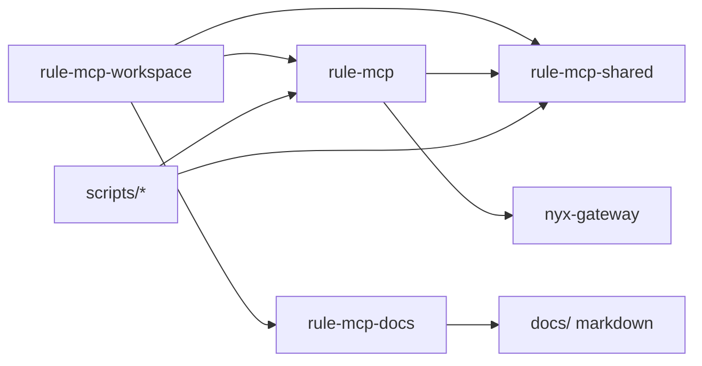

# Plan: pnpm workspace with `packages/{mcp,shared,docs}` + sibling Nyx

- **Date**: 2026-10-01
- **Updated**: 2026-10-01 (package names `rule-mcp*`; shared boundary re-audited)
- **Status**: planned (not executed)
- **Branch (when executing)**: `refactor/packages-mcp-nyx-workspace`
- **Repos**: workspace root (this git tree) + sibling `../nyx` (`nyx-gateway`)

## Goal

1. Real **pnpm workspace** under `rule-mcp`.
2. `src/` → **`packages/mcp`** (server), minus extracted shared/utils.
3. Cross-cutting helpers → **`packages/shared`**.
4. Docs site builder → **`packages/docs`** (ex `scripts/docs-site`).
5. Nyx stays sibling `../nyx`, workspace-linked.
6. Relocate tests + case-study apps; retarget every consumer.

## Package names (fixed)

| Path | `package.json` `name` | Role |
| --- | --- | --- |
| repo root | `rule-mcp-workspace` (`private: true`) | Facade: `bin/`, top-level scripts, `files`/publish orchestration |
| `packages/mcp` | **`rule-mcp`** | MCP server implementation (what agents run) |
| `packages/shared` | **`rule-mcp-shared`** | Helpers usable by root, mcp, docs, scripts |
| `packages/docs` | **`rule-mcp-docs`** | Static site builder over `docs/` markdown |
| `../nyx` | `nyx-gateway` | Sibling decision engine (unchanged git) |

Root cannot keep the name `rule-mcp` if `packages/mcp` owns that name — otherwise pnpm has two packages with the same identity. The **published/installable product name** remains `rule-mcp` on `packages/mcp` (root bin depends on it / re-exports entry).

## Fixed layout decisions

| Choice | Value |
| --- | --- |
| Workspace members | `packages/*` + `../nyx` |
| Nyx import | `nyx-gateway/mcp` |
| MCP deps | `"rule-mcp-shared": "workspace:*"`, `"nyx-gateway": "workspace:*"` |
| Docs deps | `marked` (+ workspace shared only if needed; today docs-site needs neither) |
| Alias | `@mcp/*` → `packages/mcp/`; shared via package imports `rule-mcp-shared` / `rule-mcp-shared/…` |
| `tests/` | → `scripts/__tests__/` |
| Case-study apps | → `docs/case-studies/` |
| Launcher | `scripts/case-studies/` |
| Markdown `docs/**` | stays content tree (not the docs package) |
| `personas/` / `skills/` / root `prompts/` | stay at repo root |

---

## `packages/shared` — audited contents

### IN (this rework)

**1. Entire current [`src/shared/`](../../src/shared/)**

- `index.js`, `_guardrail.js`, `_process.js`, `_result.js`, `_testkit.js`
- `ports/` (`_memory`, `_file`, `_file-io`, …)
- `__tests__/`

Rationale: already designed as “cross-cutting helpers with a single home”; used across cli/tools/core/cache/self-update/transport.

**2. Entire current [`src/utils/`](../../src/utils/)**

- `_sandbox.js` — `safeJsonParse`, `withTimeout`, `trySafe`, …
- `_request-wrapper.js` — HTTP handler timeout/recovery
- `_storm-guard.js` — process error storm cap
- `index.js` barrel + `__tests__/`

Rationale: Node resilience helpers with **no** MCP protocol / skills / tools coupling. Useful to any workspace package or root script that runs a long-lived process. Today only the server imports them; moving them into shared is still correct so root/docs/future packages can reuse them without reaching into mcp.

After the move, `packages/mcp` depends on `rule-mcp-shared` and imports sandbox/storm-guard from there (delete `packages/mcp/utils` or leave a thin re-export shim **only if** needed for one release — **concrete: no shim**, update imports).

### OUT (stay in `packages/mcp`)

| Module | Why it stays in mcp |
| --- | --- |
| `core/text` (compression, fingerprint, en-english, …) | Couples to `core/telemetry` and `core/bm25`; not a leaf helper. Scripts that use it import mcp. Extract later only with a split that removes those edges. |
| `core/commit`, `core/git` | Repo governance / git CLI domain |
| `core/file-tree` | Project layout rules for this product |
| `core/bm25`, `core/skills`, `core/guardrails` | Skill/search/product engine |
| `core/nyx` | Thin adapter specific to loading `nyx-gateway` inside mcp |
| `core/tokensave`, `core/telemetry`, `core/session`, `core/cache`, … | Server runtime |
| `cli/`, `tools/`, `server/`, `transport/`, `prompts/`, `resources/` | MCP product surface |
| Skill guardrail “SDK” | ADR 089: injection, not a shared package dependency |

### Explicit non-goals for shared growth

- Do **not** vacuum every module that scripts import from mcp into shared.
- Do **not** make skills depend on `rule-mcp-shared`.
- A follow-up ADR may extract a `rule-mcp-text` (or fold pure fingerprint into shared) **after** telemetry/bm25 edges are cut.

---

## `packages/docs`

- Move [`scripts/docs-site/`](../../scripts/docs-site/) → `packages/docs/`
- Package name: `rule-mcp-docs`
- Root: `"docs:dev"` / `"docs:build"` → `pnpm --filter rule-mcp-docs …`
- Content remains `docs/**`; output remains `site-dist/` unless a later change says otherwise

---

## Target tree

```text
rule-mcp/                    # git root; package name: rule-mcp-workspace
├── bin/rule-mcp.js          # entry → packages/mcp
├── packages/
│   ├── shared/                    # rule-mcp-shared  (ex src/shared + src/utils)
│   ├── mcp/                       # rule-mcp         (ex src/ minus shared+utils)
│   └── docs/                      # rule-mcp-docs    (ex scripts/docs-site)
├── scripts/
│   ├── alias-hook.mjs
│   ├── __tests__/                 # ex tests/
│   ├── build/ ci/ data/ fix/ install/ release/ reports/
│   ├── reports/nyx-*
│   └── case-studies/              # launcher
├── docs/                          # markdown + case-study apps + plans
├── personas/ skills/ prompts/
├── package.json
└── pnpm-workspace.yaml

../nyx/                            # nyx-gateway
```



## pnpm workspace

```yaml
packages:
  - "packages/*"
  - "../nyx"
```

## Execution order

1. Branch `refactor/packages-mcp-nyx-workspace`
2. Create `packages/`; `git mv src/shared packages/shared`; `git mv src/utils packages/shared/utils` (or flatten utils files into shared root — **concrete: keep `packages/shared/utils/*` subfolder** matching today’s module paths, export from shared `package.json` `exports`)
3. Add `packages/shared/package.json` (`rule-mcp-shared`) with exports for `.`, `./ports`, `./utils`, etc. as needed
4. `git mv src packages/mcp`; add `packages/mcp/package.json` (`rule-mcp`); depend on shared + nyx-gateway; fix imports
5. `git mv scripts/docs-site packages/docs`; add `rule-mcp-docs`; retarget root scripts; move `marked`
6. Rename root package to `rule-mcp-workspace` (private); keep public bin name `rule-mcp`
7. Move tests → `scripts/__tests__`; case-studies → `docs/case-studies`
8. Workspace yaml, alias `@mcp`, Docker/CI/census, Nyx specifier `nyx-gateway/mcp`
9. Sweep + ADR 134
10. Commits by concern

### Shared export shape (concrete)

```json
{
  "name": "rule-mcp-shared",
  "type": "module",
  "exports": {
    ".": "./index.js",
    "./ports": "./ports/index.js",
    "./utils": "./utils/index.js",
    "./package.json": "./package.json"
  }
}
```

(`_testkit` stays reachable from the main barrel or `./testkit` if we want to keep it off the default prod surface — **concrete: keep on main barrel as today**, tests already import it from shared.)

## Closing sweep

Must find zero hits for:

- `src/shared`, `src/utils`, `packages/mcp/shared`, `packages/mcp/utils` (unless intentional re-export — we choose none)
- `scripts/docs-site`
- `@src/`, bare `nyx/mcp`
- root `package.json` `"name": "rule-mcp"` (should be workspace name)

## Risks

- Root rename vs npm publish/docs that say the root package name is `rule-mcp` — update README/CONTRIBUTING/install paths to “workspace root + package `rule-mcp`”
- Under-extraction of text left in mcp (accepted)
- Sibling Nyx missing in CI → `RULE_MCP_NO_NYX=1`
- `getRepoRoot` depth after move

## Out of scope

- Vendoring nyx
- Extracting `core/text` into shared
- Skills depending on shared
- Extra packages beyond `mcp` / `shared` / `docs`

## Model assignment

Classes and evidence: section 14 of `docs/plans/plan-of-plans.md`.

| Step | Class | Model | Why |
| ---- | ----- | ----- | --- |
| the whole plan | `T5-bulk` | `minimax-m3.1-flash` | a layout move across many files, checked by gates |

Plan default: `T5-bulk` - `minimax-m3.1-flash`. Fallback: `step-5-preview` for authoring, `glm-5.3-flash` for bulk edits.
