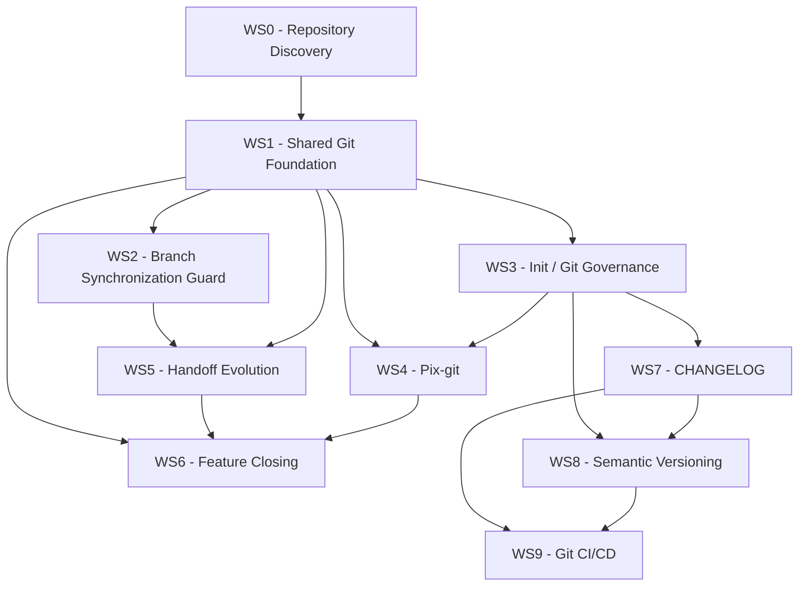

# Pix MCP - Git Workflow Evolution Plan

## 1. Obiettivo

Evolvere il server MCP locale di Pix per introdurre un workflow Git deterministico e standardizzato che copra l'intero ciclo di vita di una feature:

```text
feature branch
    ↓
development session
    ↓
/rule-handoff
    ↓
atomic commits + ADR + handoff document
    ↓
/rule-handon
    ↓
development session
    ↓
...
    ↓
feature completed
    ↓
close feature
    ↓
squash
    ↓
single Conventional Commit
    ↓
Pull Request
    ↓
merge / fast-forward
    ↓
Semantic Versioning
    ↓
CHANGELOG
    ↓
release
```

Il sistema deve privilegiare operazioni deterministiche.

Git deve essere la source of truth per:

- branch ancestry
- merge-base
- commit range
- branch divergence
- working tree status
- commit history
- presenza di merge commit
- stato rispetto al branch di origine

L'LLM deve essere utilizzato esclusivamente quando serve interpretazione semantica, per esempio:

- generazione dei commit message
- identificazione semantica di commit atomici
- generazione ADR
- sintesi degli handoff
- generazione del commit finale della feature
- proposta di correzione dei commit message

Non utilizzare un LLM per dedurre informazioni che Git può determinare direttamente.

## 2. Principi architetturali

### 2.1 Deterministic first

Prima di utilizzare un LLM verificare sempre se l'informazione può essere ottenuta deterministicamente.

Preferire:

```bash
git status
git diff
git log
git merge-base
git rev-list
git branch
git show
```

o equivalenti API Git.

### 2.2 Human confirmation gate

Qualunque operazione che modifica o riscrive la history Git deve richiedere conferma esplicita.

In particolare:

- rebase
- reword
- squash
- eliminazione merge commit
- riscrittura di commit esistenti
- normalizzazione della history

Nessuna di queste operazioni deve partire automaticamente.

### 2.3 Safe by default

I comandi devono essere non distruttivi per default.

Le operazioni distruttive devono:

1. analizzare lo stato corrente;
2. mostrare cosa verrà modificato;
3. mostrare il range dei commit interessati;
4. verificare il working tree;
5. richiedere conferma;
6. eseguire l'operazione;
7. verificare il risultato.

### 2.4 Idempotency

`/rule-init` deve essere idempotente.

Esecuzioni successive non devono:

- duplicare configurazioni;
- duplicare hook;
- duplicare dipendenze;
- sovrascrivere configurazioni valide;
- rompere pipeline esistenti.

Deve seguire il principio:

```text
missing      -> install
incomplete   -> integrate / repair
correct      -> preserve
```

## 3. Conventional Commit Standard

Tutto il sistema deve utilizzare un'unica regola centralizzata per la validazione dei commit.

Formato obbligatorio:

```text
type(scope): message
```

Esempi validi:

```text
feat(auth): add OAuth authentication
fix(header): prevent navigation overflow
refactor(api): simplify request pipeline
docs(adr): document authentication strategy
```

Esempi non validi:

```text
feat: add authentication
feat(auth) add authentication
Added authentication
fix: something
```

La validazione non deve essere implementata tramite regex duplicate in punti differenti.

Creare una singola utility/configurazione condivisa utilizzata da:

- commit validation;
- Git hooks;
- `/rule-git`;
- `/rule-handoff`;
- feature closing;
- CI.

Supportare anche Conventional Commits con breaking changes:

```text
feat(api)!: replace authentication API
```

e, quando appropriato:

```text
BREAKING CHANGE: authentication API has changed
```

## 4. Workstream WS0 - Repository Discovery

### WS0.1 Analizzare l'architettura esistente

Prima di modificare codice:

- identificare struttura del server MCP;
- identificare runtime e package manager;
- individuare implementazione delle skill;
- individuare registrazione MCP tools;
- individuare slash command esistenti;
- individuare `/rule-init`;
- individuare `/rule-handoff`;
- individuare `/rule-handon`;
- individuare utilities Git esistenti;
- individuare gestione ADR;
- individuare gestione handoff;
- individuare test framework;
- individuare configurazione Git CI.

#### Deliverable

Produrre una breve mappa interna:

```text
component -> file(s) -> responsibility
```

Non iniziare refactoring strutturali prima di avere completato questa analisi.

### WS0.2 Identificare primitive riutilizzabili

Verificare se esistono già astrazioni per:

- Git execution;
- confirmation gate;
- filesystem;
- configuration;
- MCP tool registration;
- command registration;
- LLM invocation;
- logging;
- error handling.

Riutilizzarle quando possibile.

Evitare implementazioni parallele della stessa responsabilità.

## 5. Workstream WS1 - Shared Git Foundation

Dipende da `WS0`.

### WS1.1 Git repository state

Implementare utility deterministiche per ottenere:

- current branch;
- upstream/base branch;
- working tree status;
- HEAD;
- merge-base;
- branch divergence;
- commits ahead;
- commits behind;
- commit range;
- merge commits;
- commit metadata.

### WS1.2 Base branch detection

Determinare in maniera affidabile il branch dal quale è nata la feature.

Quando disponibile utilizzare configurazione esplicita.

In assenza di configurazione utilizzare informazioni Git deterministiche.

Non chiedere all'LLM di dedurre il branch base.

Supportare almeno:

```text
develop
main
master
custom base branch
```

### WS1.3 Feature commit range

Creare una primitive condivisa:

```text
getFeatureCommitRange()
```

Concettualmente:

```text
merge-base(baseBranch, currentBranch)..HEAD
```

Questa primitive deve essere utilizzata da:

- handoff;
- close feature;
- git audit;
- squash;
- changelog/release logic quando appropriato.

### WS1.4 Working tree safety

Prima di qualsiasi history rewrite verificare:

```text
staged changes
unstaged changes
untracked files
ongoing merge
ongoing rebase
ongoing cherry-pick
```

Non iniziare operazioni distruttive in uno stato Git ambiguo.

## 6. Workstream WS2 - Branch Synchronization Guard

Dipende da `WS1`.

### WS2.1 Base branch freshness check

Implementare una funzione deterministica:

```text
checkBaseBranchFreshness()
```

Deve verificare se il branch base contiene commit non presenti nel feature branch.

Output strutturato, per esempio:

```text
baseBranch
mergeBase
ahead
behind
requiresRebase
```

### WS2.2 Event-driven checks

Il controllo non deve essere temporizzato tramite polling.

Deve essere attivato nei punti utili di interazione tra coding agent e MCP server.

Agganciarlo al maggior numero possibile di lifecycle event appropriati disponibili nell'architettura corrente, inclusi:

- slash command invocation;
- MCP tool invocation;
- session lifecycle hook;
- command lifecycle hook;
- altri hook disponibili che rappresentino attività reale dell'utente.

Evitare controlli inutilmente duplicati all'interno della stessa operazione.

### WS2.3 Rebase proposal

Quando il base branch è avanzato:

1. rilevare deterministicamente la divergenza;
2. informare l'utente;
3. mostrare branch e stato;
4. proporre il rebase;
5. richiedere conferma;
6. solo dopo conferma eseguire il rebase.

Mai effettuare automaticamente il rebase.

### WS2.4 Rebase verification

Dopo il rebase verificare:

- successo dell'operazione;
- assenza di rebase incompleto;
- nuovo merge-base;
- stato working tree;
- posizione del feature branch rispetto al base branch.

Gestire esplicitamente eventuali conflitti senza nasconderli o risolverli arbitrariamente tramite LLM.

## 7. Workstream WS3 - `/rule-init` Git Governance

Dipende da `WS1`.

### WS3.1 Husky initialization

Estendere `/rule-init` affinché rilevi la configurazione Husky.

Comportamento:

```text
not installed -> install
installed but incomplete -> integrate
correctly configured -> preserve
```

Utilizzare il package manager già adottato dal repository.

Non sostituire arbitrariamente configurazioni esistenti.

### WS3.2 Commit message validation

Configurare un hook `commit-msg`.

Validare obbligatoriamente:

```text
type(scope): message
```

Un commit non conforme deve essere rifiutato.

Il messaggio di errore deve:

- spiegare perché il commit è stato rifiutato;
- mostrare il formato corretto;
- mostrare almeno un esempio valido.

### WS3.3 Pre-push validation

Configurare un hook `pre-push`.

Prima del push verificare tutti i commit rilevanti che stanno per essere inviati.

Se viene trovato un commit non conforme:

```text
BLOCK PUSH
```

Mostrare:

- SHA breve;
- commit message;
- motivo dell'errore.

### WS3.4 Shared validator

`commit-msg` e `pre-push` devono utilizzare la stessa implementazione della regola Conventional Commit.

Non duplicare regex o logica.

## 8. Workstream WS4 - `/rule-git`

Dipende da `WS1` e `WS3`.

Creare il nuovo slash command:

```text
/rule-git
```

### WS4.1 Default audit mode

Per default il comando deve essere safe/read-only.

Analizzare la feature history e produrre un report contenente:

- base branch;
- merge-base;
- commit range;
- numero commit;
- Conventional Commit violations;
- merge commit presenti;
- eventuali anomalie Git rilevanti.

### WS4.2 Conventional Commit normalization

Per ogni commit non conforme:

1. analizzare il contenuto del commit;
2. proporre un nuovo Conventional Commit message;
3. mostrare `OLD -> NEW`;
4. richiedere conferma;
5. dopo conferma effettuare il reword;
6. verificare la nuova history.

L'LLM può proporre il messaggio.

La selezione dei commit deve essere deterministica.

### WS4.3 Merge commit detection

Individuare deterministicamente merge commit presenti nella feature history.

Non limitarsi a cercare stringhe nei commit message.

Utilizzare la topologia Git.

### WS4.4 History normalization

Supportare una modalità:

```text
/rule-git --force
```

`--force` abilita la proposta di operazioni di history normalization.

Non deve eliminare il confirmation gate.

Semantica:

```text
--force = allow destructive proposals
```

NON:

```text
--force = execute without confirmation
```

### WS4.5 Merge commit removal

Quando vengono trovati merge commit, proporre la trasformazione della feature history in una history lineare equivalente.

Requisito fondamentale:

> Eliminare i merge commit preservando esattamente il contenuto finale del feature branch.

Non assumere semplicemente che ogni merge commit possa essere squashato nel commit immediatamente precedente.

Utilizzare la strategia Git appropriata in base alla topologia reale.

### WS4.6 Post-normalization verification

Dopo la normalizzazione verificare che:

```text
final tree before == final tree after
```

La normalizzazione della history non deve modificare il risultato finale del codice.

## 9. Workstream WS5 - Handoff Evolution

Dipende da `WS1` e `WS2`.

Preservare il comportamento corrente di `/rule-handoff`.

### WS5.1 Existing handoff workflow

Il normale handoff deve continuare a:

1. analizzare `git diff`;
2. identificare modifiche;
3. creare commit atomici;
4. utilizzare Conventional Commits;
5. creare gli ADR appropriati;
6. salvarli in `docs/adr/`;
7. creare il documento di handoff;
8. includere almeno ADR summary, commit range, conversation/session summary, continuation context e prompt/context for `/rule-handon`.

### WS5.2 Handoff commits

I commit generati automaticamente devono utilizzare obbligatoriamente:

```text
type(scope): message
```

Riutilizzare il validator centrale di WS3.

## 10. Workstream WS6 - Feature Closing

Dipende da `WS1`, `WS4` e `WS5`.

Estendere `/rule-handoff` con una modalità esplicita di chiusura feature.

API suggerita:

```text
/rule-handoff --close-feature --squash
```

Se l'architettura attuale suggerisce una sintassi migliore, mantenerne la semantica ma adattare la forma.

### WS6.1 Feature boundary

Determinare il range esclusivamente tramite Git.

Utilizzare:

```text
merge-base(baseBranch, featureBranch)..HEAD
```

Non utilizzare l'LLM per determinare dove inizia la feature.

### WS6.2 Pre-close validation

Prima dello squash:

- verificare working tree;
- verificare branch;
- verificare base branch;
- verificare eventuale divergenza;
- proporre eventuale rebase;
- verificare commit range;
- verificare merge commit;
- verificare Conventional Commit compliance.

Se necessario suggerire `/rule-git` prima della finalizzazione.

### WS6.3 Feature synthesis

Raccogliere:

- commit della feature;
- commit message;
- diff complessivo;
- ADR associati;
- handoff document;
- decisioni architetturali rilevanti.

Utilizzare questi dati per costruire semanticamente il commit finale.

### WS6.4 Final commit generation

Generare un singolo commit:

```text
type(scope): feature summary
```

Il commit deve rappresentare l'intera feature, non l'ultima sessione.

Deve inoltre determinare correttamente:

- type;
- scope;
- eventuale breaking change;
- summary.

Questo commit sarà potenzialmente utilizzato come:

- commit della PR;
- titolo della Pull Request;
- input Semantic Versioning;
- input CHANGELOG;
- input release automation.

### WS6.5 Squash

Mostrare prima all'utente:

```text
base branch
merge-base
commit count
commit range
commits being squashed
proposed final commit
```

Richiedere conferma.

Solo dopo conferma effettuare lo squash.

### WS6.6 Squash verification

Dopo lo squash verificare:

```text
feature commit count == 1
final tree unchanged
commit format valid
working tree clean
```

## 11. Workstream WS7 - Automated CHANGELOG

Dipende da `WS3`.

Integrarlo in `/rule-init`.

### WS7.1 Existing configuration discovery

Prima di installare qualcosa verificare se il repository possiede già:

- changelog tooling;
- release tooling;
- semantic version tooling;
- Git release automation;
- package versioning;
- tag automation.

Riutilizzare soluzioni esistenti se compatibili.

### WS7.2 CHANGELOG generation

Configurare la generazione automatica del changelog a partire dai Conventional Commits.

La history Git deve essere la source of truth.

Evitare changelog mantenuti manualmente quando l'informazione è derivabile dalla history.

## 12. Workstream WS8 - Semantic Versioning

Dipende da `WS3` e `WS7`.

Configurare Semantic Versioning guidato dai commit.

Semantica minima:

```text
fix      -> PATCH
feat     -> MINOR
breaking -> MAJOR
```

Supportare:

```text
type(scope)!: message
```

e:

```text
BREAKING CHANGE:
```

quando previsto dallo standard/tool scelto.

La versione non deve essere scelta manualmente quando può essere derivata deterministicamente dalla commit history.

## 13. Workstream WS9 - Git CI/CD Integration

Dipende da `WS7` e `WS8`.

### WS9.1 Pipeline discovery

Analizzare `.Git-ci.yml` e qualsiasi configurazione CI inclusa.

Non sostituire la pipeline esistente.

### WS9.2 Pipeline integration

Integrare gli stage/job necessari per:

```text
validate commits
determine semantic version
generate/update changelog
create tag
create release
```

quando compatibile con il workflow corrente del repository.

### WS9.3 Fast-forward workflow

Assumere che il repository utilizzi un workflow Git lineare e fast-forward.

La soluzione deve evitare di reintrodurre merge commit nel normale workflow.

## 14. Dependency Graph



## 15. Recommended Linear Execution Order

Implementare nell'ordine seguente:

```text
01. WS0 - Repository Discovery
02. WS1 - Shared Git Foundation
03. WS3 - Git Governance foundation
04. WS2 - Branch Synchronization Guard
05. WS4 - /rule-git
06. WS5 - Handoff Evolution
07. WS6 - Feature Closing
08. WS7 - CHANGELOG
09. WS8 - Semantic Versioning
10. WS9 - Git CI/CD
```

Quando due workstream sono indipendenti dopo il completamento delle loro dipendenze, mantenere comunque questo ordine se l'implementazione viene eseguita da un singolo coding agent.

## 16. Testing Strategy

Ogni workstream deve introdurre test appropriati.

Coprire almeno:

### Git history

```text
clean linear history
branch ahead
base branch ahead
diverged branches
merge commits
multiple merge commits
dirty working tree
ongoing rebase
ongoing merge
```

### Conventional Commits

```text
valid type(scope): message
missing scope
missing type
invalid separator
breaking change
multiple invalid commits
```

### Handoff

```text
single session
multiple sessions
multiple atomic commits
ADR generation
handoff generation
```

### Feature closing

```text
one commit
many commits
base branch updated
dirty working tree
merge commit present
invalid commit present
successful squash
```

### Critical invariant

Per ogni history rewrite verificare sempre:

```text
git tree before == git tree after
```

quando l'operazione non dovrebbe modificare il contenuto finale.

## 17. Acceptance Criteria

L'implementazione è completa quando:

- `/rule-init` può essere eseguito più volte senza effetti collaterali;
- Husky viene installato/configurato correttamente;
- commit non conformi vengono bloccati;
- push contenenti commit non conformi vengono bloccati;
- il validator Conventional Commit è centralizzato;
- il server rileva frequentemente, tramite eventi, gli aggiornamenti del base branch;
- nessun rebase viene effettuato senza conferma;
- `/rule-git` può effettuare audit della feature history;
- `/rule-git` propone la correzione dei commit non conformi;
- `/rule-git --force` può proporre la linearizzazione della history;
- `--force` non bypassa mai il confirmation gate;
- la normalizzazione elimina merge commit senza modificare il final tree;
- `/rule-handoff` continua a produrre commit atomici, ADR e handoff;
- la chiusura feature determina deterministicamente il commit range;
- la feature può essere squashata in un singolo Conventional Commit;
- il commit finale rappresenta semanticamente l'intera feature;
- CHANGELOG viene derivato dai Conventional Commits;
- Semantic Versioning viene derivato dai Conventional Commits;
- Git CI integra release/version/changelog senza distruggere pipeline esistenti;
- il workflow finale mantiene una Git history lineare.

## 18. Implementation Rules for the Coding Agent

Durante l'implementazione:

1. Non inventare API o strutture prima di aver analizzato il repository.
2. Riutilizzare le astrazioni esistenti quando appropriate.
3. Evitare refactoring non necessari al task.
4. Preferire funzioni piccole, testabili e deterministiche.
5. Separare Git operations da LLM operations.
6. Non utilizzare LLM per informazioni ottenibili tramite Git.
7. Non eseguire history rewrite senza confirmation gate.
8. Non utilizzare `--force` per bypassare confirmation gate.
9. Non sovrascrivere configurazioni esistenti se possono essere integrate.
10. Rendere `/rule-init` idempotente.
11. Centralizzare Conventional Commit parsing e validation.
12. Preservare backward compatibility dei comandi esistenti quando possibile.
13. Aggiungere test insieme a ogni workstream, non alla fine.
14. Dopo ogni workstream eseguire test, lint e typecheck disponibili nel repository.
15. Non procedere al workstream successivo finché quello corrente non soddisfa i relativi acceptance criteria.

## 19. Execution Protocol

Procedi un workstream alla volta.

Per ogni workstream:

```text
1. Inspect
2. Plan
3. Implement
4. Test
5. Verify
6. Summarize
7. Continue
```

Prima di implementare, identifica sempre i file realmente coinvolti.

Alla fine di ogni workstream restituisci un riepilogo conciso:

```markdown
## WSx completed

### Changed

- ...

### Tests

- ...

### Verification

- ...

### Decisions

- ...

### Next

WSy - ...
```

Non limitarti a descrivere il codice da scrivere.

Implementa concretamente le modifiche nel repository.

Quando incontri un'ambiguità che può essere risolta analizzando codice, Git o configurazioni esistenti, risolvila autonomamente.

Chiedi conferma all'utente esclusivamente quando:

- l'operazione è distruttiva;
- è richiesta una decisione di prodotto/architettura non deducibile dal repository;
- esistono alternative incompatibili senza una scelta chiaramente preferibile;
- una history rewrite deve essere eseguita.

L'obiettivo finale è ottenere un workflow Pix in cui lo sviluppatore possa lavorare liberamente con commit atomici durante le sessioni, mantenere automaticamente memoria tecnica tramite ADR e handoff, sincronizzarsi in sicurezza con il branch di origine e, al completamento della feature, ottenere una history lineare composta da un singolo commit semanticamente significativo che alimenti automaticamente PR, CHANGELOG, Semantic Versioning e release Git.

## 20. ONE MORE THING

Nelle regole di `/rule-init` e di `/rule-handoff` dobbiamo aggiungere in modo MANDATORIO che venga forzato l'aggiornamento di tutte le dipendenze, che DEVONO essere gestite così `"nome-dipendenza": "x.y.z"` (mai come `"nome-dipendenza": "^x.y.z"` o `"nome-dipendenza": "~x.y.z"`) perché così evitiamo che le sub dependencies vengano portate dentro senza il nostro controllo, e ci schermiamo da potenziali problemi non voluti
