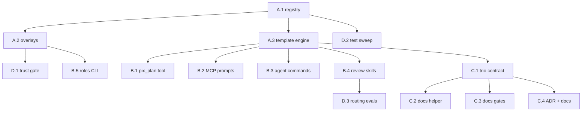

# Review Personas: Expert Audit → Review → Plan Pipeline

- **Date**: 2026-09-03
- **Status**: approved (interview decisions recorded below)
- **Owner**: rule-mcp
- **Scope**: a registry of expert review personas and the surfaces that expose them (MCP prompts, agent commands, a tool, skills), driving one operation — an audit that produces a review and generates a plan, as three markdown documents kept in sync on every invocation
- **Related**: `2026-09-03-security-privacy-ai-hardening.md` (step 4.4 shares the untrusted-content boundary with the project overlay here)

## The template (source of truth)

Every persona fills this template — verbatim placeholders, nothing else invented:

```text
agisci come un {{ROLE}} con più di {{YEARS_OF_EXPERIENCE}} anni di esperienza,
con specializzazione in {{SKILL_1}}, ..., {{SKILL_X}}
e crea un piano di bugfix/rework/il necessario per sistemare il progetto nel migliore dei modi
anche in modo che sia inappuntabile sotto i punti di vista di quelle tematiche relative alle sue skills,
cerca notizie su internet o articoli per capire meglio se c'è qualcos'altro che possiamo fare a questa repo

se hai bisogno andiamo in modalità intervista per sciogliere tutti i nodi

l'output di questo lavoro deve essere un piano con roadmap organizzate in step e dipendenze,
in formato markdown nella cartella ./docs/plans
```

The registry supplies `ROLE`, `YEARS_OF_EXPERIENCE` and the `SKILL_*` list; the operation contract (section "The operation") extends the output requirement from one document to the audit/review/plan trio.

## Interview decisions (2026-09-03)

1. **All four surfaces**, with consistent per-surface prefixes (naming contract below).
2. **Core roles active in v1** (6 from the first interview, plus `docs-engineer` added by addendum below), the rest enter the registry as `proposed`.
3. **Embedded registry + user overlay + project overlay**, precedence `project > user > embedded`; deprecation via `status`, never by deletion.
4. **One operation, three documents**: every invocation runs an audit, distills it into a review, and generates a plan — writing, updating, or deleting `docs/audits/<role>.md`, `docs/reviews/<role>.md`, `docs/plans/<role>.md` so the trio always reflects the latest run.

**Addendum (2026-09-03, same day)**: a **Senior Documentation Engineer** role joins the active set. It reviews everything the project says about itself — docs, ADRs, comments, JSDoc, type annotations — with whole-project vision, and plans what to write, update, or deprecate, reading the commit history to find what drifted. Its editorial bar is written into its lenses: lean, elegant, understandable; never verbose, repetitive, redundant — documentation that flows like fresh water. It absorbs the `proposed` `tech-writer` role: keeping both would be exactly the redundancy this role exists to remove.

## Naming contract

One role id, four surfaces, one prefix family per surface (case follows each surface's convention):

| Surface            | Name pattern                                      | Example (`security`)             | Delivered by                                |
| ------------------ | ------------------------------------------------- | -------------------------------- | ------------------------------------------- |
| MCP prompt         | `rule-prompts-<role>`                          | `/rule-prompts-security`      | `prompts/` registration, from the registry  |
| Agent command      | `rule-plan-<role>`                             | `/rule-plan-security`         | existing agent-commands generator (ADR 029) |
| Skill (+ its tool) | `rule-review-<role>` → `pix_review_<role>` | `pix_review_security`        | generated skill dirs, auto-discovered       |
| Tool (generic)     | `pix_plan` with `role` argument               | `pix_plan {role:"security"}` | tool registry                               |

The generic `pix_plan` is the composable entry (custom roles on the fly, overrides); the per-role surfaces are conveniences generated from the same registry. A `deprecated` role disappears from every generated surface but keeps its registry entry and its documents.

## Registry

### Schema (validated with zod, like every tool input)

```jsonc
{
  "id": "security", // kebab-case, stable, never reused
  "role": "Security Engineer", // {{ROLE}}
  "yearsOfExperience": 25, // {{YEARS_OF_EXPERIENCE}}
  "skills": [
    // {{SKILL_1}}..{{SKILL_X}}, ordered
    "application security",
    "supply chain security",
    "MCP/agent security",
  ],
  "evidenceSkills": [
    // rule skills loaded as evidence before auditing
    "rule-backend-security",
    "rule-devops-docker",
  ],
  "lenses": [
    // the focus checklist appended to the template
    "authn/authz on every transport",
    "input validation and ReDoS",
    "secrets handling",
    "...",
  ],
  "status": "active", // active | proposed | deprecated
  "version": 1, // bumped on any change; deprecation bumps too
  "deprecatedBy": null, // role id that replaces it, when status=deprecated
}
```

### Layers and precedence

| Layer    | Where                                   | Who edits it                                                                                    | Wins over      |
| -------- | --------------------------------------- | ----------------------------------------------------------------------------------------------- | -------------- |
| Embedded | `src/core/review-roles.js` (catalog)    | PRs to this repo                                                                                | —              |
| User     | `~/.rule-mcp/config/roles/*.json` | the user, or `rule-mcp roles` CLI                                                         | embedded       |
| Project  | `./.rule-mcp/roles/*.json`        | the team, committed? No — the dir is gitignored; project roles are local per-checkout by design | user, embedded |

Merge is by `id`: an overlay entry replaces the lower layer's entry wholesale (no field-level merging — partial merges make "which lens applies" undebuggable). Invalid overlay files are reported and skipped, never fatal.

**Trust boundary (security-critical)**: the project overlay is repository-adjacent content. A hostile checkout must not be able to plant a persona whose lenses smuggle instructions. Project-layer roles therefore require explicit one-time acceptance per role id+version (the full role text is shown before first use), and every overlay-sourced text field is emitted inside the same "data, not instructions" fences that hardening step 4.4 defines. User-layer roles are the user's own machine and load without ceremony.

## Role catalog v1

### Active (core 7)

| id              | Role                          | Years | Specializations (`skills`)                                                                                                                  | `evidenceSkills` (main)                                                                                                                             |
| --------------- | ----------------------------- | ----- | ------------------------------------------------------------------------------------------------------------------------------------------- | --------------------------------------------------------------------------------------------------------------------------------------------------- |
| `architect`     | Software Architect            | 30    | architecture & modularity, API/module boundaries, coupling & cohesion, ADR discipline, evolutionary design                                  | `rule-styleguide-patterns`, `rule-process-adr`, `rule-backend-api-design`                                                                  |
| `security`      | Security Engineer             | 25    | application security, supply chain security, MCP/agent security, threat modeling                                                            | `rule-backend-security`, `rule-devops-docker`                                                                                                 |
| `privacy`       | Privacy & Compliance Engineer | 20    | GDPR, EU AI Act, data minimization, retention & erasure, telemetry ethics                                                                   | `rule-backend-security`, `rule-process-documentation`                                                                                         |
| `a11y`          | Accessibility Expert          | 20    | WCAG 2.2 AA, assistive technologies, a11y test automation, inclusive UX                                                                     | `rule-styleguide-a11y`, `rule-devops-testing`                                                                                                 |
| `ai-engineer`   | AI Engineer                   | 15    | agent architectures, evals, prompt & context engineering, token economics, LLM security                                                     | `rule-mcp-agent-architecture`, `rule-mcp-evals`, `rule-mcp-context-engineering`                                                               |
| `performance`   | Performance Engineer          | 20    | Node event loop & workers, caching, bundle & startup cost, measurement-first optimization                                                   | `rule-backend-workers`, `rule-frontend-workers`, `rule-toolchain-vite`                                                                     |
| `docs-engineer` | Senior Documentation Engineer | 25    | documentation architecture, ADR lifecycle, JSDoc & type annotations, comment hygiene, commit-driven doc maintenance, plain-language editing | `rule-process-documentation`, `rule-styleguide-markdown`, `rule-styleguide-readme`, `rule-process-adr`, `rule-styleguide-javascript` |

### Proposed (+7, activate on demand)

| id                     | Role                        | Years | Specializations                                                                |
| ---------------------- | --------------------------- | ----- | ------------------------------------------------------------------------------ |
| `devops-sre`           | DevOps/SRE                  | 25    | CI/CD, containerization, observability, release engineering, incident response |
| `qa-testing`           | QA & Test Engineer          | 25    | TDD, coverage strategy, flakiness hunting, test pyramid, a11y test suites      |
| `data-engineer`        | Data Engineer               | 25    | schema design, migrations, SQL performance, local-first storage                |
| `design-system-lead`   | Design System Lead          | 20    | zero-class CSS, design tokens, semantic HTML, component API design             |
| `dx-toolchain`         | DX & Toolchain Engineer     | 15    | pnpm, bundlers, lint/format pipelines, monorepo ergonomics                     |
| `simplicity-staff-eng` | Staff Engineer (Simplicity) | 30    | scope discipline, YAGNI, deletion as a feature, complexity budgets             |
| `oss-compliance`       | OSS Compliance Officer      | 20    | licensing, attribution, provenance, third-party policy                         |

Roles are data: adding, tuning years, or deprecating one is a registry edit (or an overlay file), never code. (`tech-writer` was absorbed into `docs-engineer` before ever shipping, so it is simply not in the catalog rather than `deprecated`.)

### `docs-engineer`, spelled out

The one role whose subject is the project's own words, so its registry entry carries two things the others don't:

- **Lenses that are an editorial contract, not a checklist**: every document, comment, JSDoc and type it touches must come out _leaner, more elegant, more understandable_ than it went in, and _never verbose, repetitive or redundant_ — prose that flows like fresh water. A finding in its reviews can be "this paragraph exists twice", "this comment narrates the code instead of explaining the why", "this JSDoc restates the signature", "this ADR is decided-but-undocumented" — each with the shorter rewrite attached.
- **Commit history as audit input**: its audit phase diffs documentation against reality — `git log` since each document's last touch, exports that changed without their docs, ADRs whose decision the code has since walked away from, comments orphaned by refactors. Write/update/deprecate decisions are driven by what the commits show drifted, not by taste.

Scope explicitly includes: `docs/**` (guides, ADRs, handoffs, plans), `README`/`GETTING_STARTED`, JSDoc blocks and `@param`/`@returns` accuracy, inline comments (density and the say-why-not-what rule), and type annotations as documentation. Scope explicitly excludes: changing code behavior — a finding that needs a behavior change is handed to the owning role.

## The operation

One invocation — whatever surface it entered from — is a single pipeline:

```
audit (evidence) ──► review (findings) ──► plan (roadmap)
```

and manages **three documents with stable, per-role paths** (the date lives in the header, so re-runs update in place instead of littering):

| Document | Path                     | Content                                                                                           | Lifecycle on each invocation                                                                                                                           |
| -------- | ------------------------ | ------------------------------------------------------------------------------------------------- | ------------------------------------------------------------------------------------------------------------------------------------------------------ |
| Audit    | `docs/audits/<role>.md`  | evidence only: commands run with measured values, files read, web sources consulted. No opinions. | **Overwritten** — an audit is a snapshot of now                                                                                                        |
| Review   | `docs/reviews/<role>.md` | findings with id, severity, evidence pointer into the audit, and status `open/resolved`           | **Updated** — new findings appended, fixed ones flipped to `resolved` (kept one run for visibility, then removed)                                      |
| Plan     | `docs/plans/<role>.md`   | roadmap in steps with dependencies (the template's required output)                               | **Updated** — steps re-derived from open findings; **deleted** when a run finds zero open findings (the trio collapses to audit+review saying "clean") |

The filled template instructs the agent to: load the role's `evidenceSkills` via rule tools, audit evidence-first (measure, don't assume), search the web for current practice in the role's domains, go interview-mode when a decision belongs to the user, then write/update/delete the trio. A deterministic helper keeps the mechanical part honest (step C.2).

Documents from a `deprecated` role are removed by the next invocation of any role that supersedes it (`deprecatedBy`), or manually.

## Roadmap

Effort: S ≤ ½ day · M ≤ 2 days · L > 2 days. Every step lands with tests; default-shaping steps land with an ADR.

### Phase A — Registry foundation

| Step    | What                                                                                                                                                                                                                                        | Depends on | Acceptance                                                                                                 | Effort |
| ------- | ------------------------------------------------------------------------------------------------------------------------------------------------------------------------------------------------------------------------------------------- | ---------- | ---------------------------------------------------------------------------------------------------------- | ------ |
| **A.1** | Embedded registry `src/core/review-roles.js`: the 14-role catalog above, zod schema, `status`/`version`/`deprecatedBy` semantics, lookup API (`activeRoles()`, `roleById()`).                                                               | —          | Schema test; catalog validates; deprecated roles excluded from `activeRoles()`.                            | M      |
| **A.2** | Overlay loader: user (`~/.rule-mcp/config/roles/`) and project (`./.rule-mcp/roles/`) layers, precedence project > user > embedded, wholesale replace by `id`, invalid files reported-not-fatal.                                | A.1        | Precedence test matrix; hostile/invalid overlay fixtures skipped with a report.                            | M      |
| **A.3** | Template engine: fill the template verbatim from a role (ROLE, YEARS, SKILLS), append the operation contract (three documents, interview mode, web research, evidence-first) and the role's lenses + `evidenceSkills` loading instructions. | A.1        | Snapshot test: template output for `security` is byte-stable; placeholders all resolved; contract present. | S–M    |

### Phase B — Surfaces (all depend on A.3; parallelizable)

| Step    | What                                                                                                                                                                                                                                                               | Acceptance                                                                                                                                                             | Effort |
| ------- | ------------------------------------------------------------------------------------------------------------------------------------------------------------------------------------------------------------------------------------------------------------------ | ---------------------------------------------------------------------------------------------------------------------------------------------------------------------- | ------ |
| **B.1** | Tool **`pix_plan`**: args `role` (id) plus optional overrides (`years`, extra `skills`, `topic` to focus the audit). Returns the filled template + evidence pointers. Custom ad-hoc role via full inline definition (subject to the same fencing as overlays). | Tool registered; overrides test; unknown role lists available ones; tool-surface budget test updated.                                                                  | M      |
| **B.2** | MCP prompts **`rule-prompts-<role>`** for every active role, registered beside the existing prompts; prompt argument = optional `topic`.                                                                                                                        | Prompts listed via MCP; `prompts.test.mjs` extended; deprecating a role removes its prompt.                                                                            | S–M    |
| **B.3** | Agent commands **`/rule-plan-<role>`** added to the agent-commands generator registry (all supported agents, same install/uninstall lifecycle as existing commands).                                                                                            | Generated files appear per agent in install test; uninstall removes them; regeneration is idempotent.                                                                  | M      |
| **B.4** | Skills **`rule-review-<role>`**: one generated skill dir per active role (SKILL.md carries the persona, routing headings tuned so `rule` routes "agisci come un security expert…" there). Auto-creates tools `pix_review_<role>`.                        | Skills discovered; routing-corpus entries added and green; `minimal-tools`/`tool-surface-budget`/`skills-docs` tests updated (7 new tools stay within the 20k budget). | M–L    |
| **B.5** | CLI **`rule-mcp roles list\|show\|new\|deprecate`** managing the user overlay (writes the JSON, validates, prints the merged view with layer provenance).                                                                                                    | CLI test: `new` creates a valid overlay, `deprecate` flips status, `list` shows layer origin.                                                                          | M      |

### Phase C — The operation

| Step    | What                                                                                                                                                                                                           | Depends on | Acceptance                                                                                                           | Effort |
| ------- | -------------------------------------------------------------------------------------------------------------------------------------------------------------------------------------------------------------- | ---------- | -------------------------------------------------------------------------------------------------------------------- | ------ |
| **C.1** | Three-document contract in the template output: exact paths, per-document lifecycle (overwrite / update / delete rules above), header format (date, role id+version, run id).                                  | A.3        | Contract text snapshot-tested; documented in the skill.                                                              | S      |
| **C.2** | Deterministic helper `pix_plan_docs`: scaffolds/updates the trio skeletons (headers, findings table, status flips) so the mechanical bookkeeping is not left to model discipline; agent fills the content. | C.1        | Round-trip test: run → resolve a finding → re-run flips status and prunes; zero open findings deletes the plan file. | M      |
| **C.3** | Docs gates: extend `docs-scan` to validate the trio (cross-links audit↔review↔plan, no dangling finding ids, date headers).                                                                                    | C.1        | Gate fails on a broken fixture trio; green on repo.                                                                  | S–M    |
| **C.4** | ADR + docs: naming contract, overlay precedence, trio lifecycle in `docs/02-tools-operations.md`; ADR for the feature.                                                                                         | C.1        | ADR merged; docs tests green.                                                                                        | S      |

### Phase D — Safety & quality

| Step    | What                                                                                                                                                                                                                                                  | Depends on         | Acceptance                                                                                                             | Effort |
| ------- | ----------------------------------------------------------------------------------------------------------------------------------------------------------------------------------------------------------------------------------------------------- | ------------------ | ---------------------------------------------------------------------------------------------------------------------- | ------ |
| **D.1** | Project-overlay trust gate: first use of a project role shows its full text and requires acceptance (recorded per id+version in the project dir); all overlay text fields fenced as data-not-instructions (shared implementation with hardening 4.4). | A.2, hardening 4.4 | Hostile-role fixture: injected directive arrives fenced; unaccepted project role refuses to load with a clear message. | M      |
| **D.2** | Test sweep: registry/overlay/deprecation units, per-surface generation, budget tests, hostile fixtures, CLI.                                                                                                                                          | A–C                | All suites green in `pnpm run ci`.                                                                                     | M      |
| **D.3** | Routing evals: corpus entries mapping "act as a <role> …" phrasings (it/en) to the right surface.                                                                                                                                                     | B.4                | Routing corpus green with the new entries.                                                                             | S      |

### Dependency graph



**Critical path**: A.1 → A.3 → B.4 (the skills surface is the heaviest and gates routing evals). **Suggested pickup**: A.1–A.3 in one sitting, then B.1+B.2 (cheap, immediately usable), then B.4, then C, then D.1 before announcing project overlays.

## Surface impact (counted, not guessed)

- 7 new skills → 7 new tools (`pix_review_*`) + 1 action tool (`pix_plan`) + 1 helper (`pix_plan_docs`): tool count 106 → ~115; `tools/list` currently ~14.9k of the 20k budget — new entries must stay lean (short descriptions) and the budget test is the gate.
- `minimal-tools` and `skill-surface-embedded-only` assertions move (as they did for `pix_usage`).
- Agent-commands install writes 7 more command files per agent; prompt suppression config unchanged.

## Out of scope (deliberately)

- **Running the reviews automatically** (cron/CI personas): the operation stays user-invoked; scheduling is its own decision later.
- **Multi-role combined audits** ("security+privacy in one run"): compose by running two roles; a merge feature only if the trio bookkeeping proves painful.
- **Sharing project roles via git**: the project overlay lives in the gitignored `./.rule-mcp/`; a committed, team-shared role layer would reopen the trust boundary and needs its own ADR.
- **This document's own convention**: existing date-named plans (like today's hardening plan) are grandfathered; the stable-path convention applies to persona-generated documents.

---

## Execution status (2026-09-04)

| Step                           | Status      | Where                                                                                             |
| ------------------------------ | ----------- | ------------------------------------------------------------------------------------------------- |
| A.1 registry                   | done        | `src/core/review-roles.js` - 14 roles, 7 active, validation without a new dependency              |
| A.2 overlay loader             | done        | `src/core/review-roles-overlays.js` - user > embedded since ADR 082, invalid files reported not fatal |
| A.3 template engine            | done        | `src/core/review-roles-template.js` - byte-stable, contract appended                              |
| B.1 pix_plan               | done        | `src/tools/plan.js`, overrides + unknown-role listing                                             |
| B.2 MCP prompts                | done        | one per active role, generated in `listPrompts()`                                                 |
| B.3 agent commands             | done        | derived from the prompts; the persona commands carry their own body (fetch the role, write the trio) since the generic one only routes |
| B.4 per-role skills            | deferred    | seven more tools against the tools/list budget for what `pix_plan` already does (ADR 072)     |
| B.5 roles CLI                  | done        | `rule-mcp roles list|show|new|deprecate` in `src/cli/roles.js`; writes through the validator, embedded catalog never edited |
| C.1 trio contract              | done        | in the template output                                                                            |
| C.2 pix_plan_docs helper   | done        | `src/core/review-docs.js` + `pix_plan_docs`; merge, flip, prune and delete are code; the template names it; ADR 075 |
| C.3 docs gates for the trio    | done        | `validateTrio()` in `src/core/review-docs.js`, wired into `test/docs-scan.mjs`: headers, cross-links, dangling finding ids, plan-outlives-findings |
| C.4 ADR + docs                 | done        | ADR 072                                                                                           |
| D.1 project-overlay trust gate | removed     | the project layer it guarded is gone (ADR 082): nothing this server reads comes from a checkout, so the gate has no subject. ADR 076 superseded |
| D.2 test sweep                 | done        | `test/review-roles.test.mjs`, `test/review-roles-surfaces.test.mjs` in ci                         |
| D.3 routing evals              | done        | `detectRole()` in the registry + `persona` in the route payload; 14 it/en phrasings and 8 negatives in the corpus |

**Naming deviation from the contract above**: the prompt and the agent command
share `rule-plan-<role>`. The command generator derives its set from the
prompt registry (ADR 029), so a second prefix would need a second registry -
exactly the drift that ADR removed. Recorded in ADR 072.
