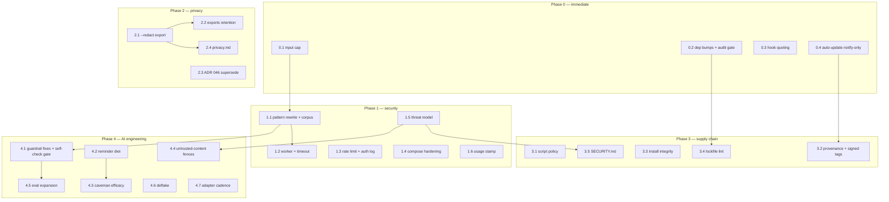

# Security, Privacy & AI Engineering Hardening Plan

- **Date**: 2026-09-03
- **Status**: approved (interview decisions recorded below)
- **Owner**: rule-mcp
- **Scope**: the whole repository — transports, telemetry, guardrails, git hooks, install/update pipeline, Docker, docs
- **Method**: evidence-first audit of this codebase (every finding below was reproduced or read in source, none is hypothetical) cross-checked against OWASP LLM/Agentic Top 10 2026, MCP security guidance, npm supply-chain incident reports and GDPR/EU-AI-Act analyses (references at the end)

## Interview decisions (2026-09-03)

These four decisions shape the roadmap and are not re-litigated by any step:

1. **ReDoS**: full depth — input cap **and** pattern rewrite **and** worker-thread isolation.
2. **Auto-update**: becomes **notify-only by default**. The check still runs and shows the banner; the merge happens only when the user runs `pix_update` / the CLI. An env flag restores the old forced fast-forward for those who want it.
3. **Flight exports**: local export stays complete; a **`--redact` share variant** strips prompt text and absolute paths. Redaction happens at share time, not at record time.
4. **Execution**: this document is the deliverable. No step starts until it is picked up explicitly.

---

## 1. Findings

Severity: 🔴 fix first · 🟠 fix soon · 🟡 planned · 🔵 hygiene/backlog

### Security

| ID   | Sev | Finding                                                                                                                                                                                                                                                                                                                                                   | Evidence                                                                                                                          |
| ---- | --- | --------------------------------------------------------------------------------------------------------------------------------------------------------------------------------------------------------------------------------------------------------------------------------------------------------------------------------------------------------- | --------------------------------------------------------------------------------------------------------------------------------- |
| F-S1 | 🔴  | **ReDoS in guardrails**: `checkCode()` on ~200 KB of adversarial input blocks the event loop for **67 s measured**. `pix_check` accepts arbitrary client code; on the shared SSE/HTTP daemon one malicious call freezes every connected client. The sandbox timeout cannot fire: the regex runs synchronously on the only thread.                     | Reproduced 2026-09-03 against `src/core/guardrails.js` via `checkCode("rule-styleguide-css", <200KB adversarial>)` → 67 018 ms |
| F-S2 | 🔴  | **10 known vulnerabilities in production dependencies**, all transitive via `@modelcontextprotocol/sdk` 1.30.0: `fast-uri` ×4, `hono` ×4, `qs` ×2 (4 high, 5 moderate, 1 low).                                                                                                                                                                            | `pnpm audit --prod`, 2026-09-03                                                                                                   |
| F-S3 | 🟠  | **Forced auto-update = rug-pull window**: every install fetches and fast-forward-merges upstream at most 60 s after a tool call. A compromised upstream (or a maintainer account takeover) is remote code execution on the whole fleet within a minute. Commit-signature verification exists but is opt-in (`RULE_MCP_UPDATE_REQUIRE_SIGNATURE=1`). | `src/core/self-update.js` — allowlisted remotes and ff-only are good, but merge is automatic by default                           |
| F-S4 | 🟠  | **Shell-quoting bug in git hooks**: hook blocks quote the node/script paths with `JSON.stringify`, which produces sh **double** quotes — `$`, backtick and `\` inside them are expanded by the shell. A home directory containing `$` breaks or injects.                                                                                                  | `src/core/git-hooks.js` `launcher()`; verified the generated hook line uses `"…"`                                                 |
| F-S5 | 🟠  | **`curl \| bash` install with no integrity check** is the documented path; nothing pins a commit or verifies a checksum. Post-Shai-Hulud this is the textbook initial-access vector for dev machines.                                                                                                                                                     | `scripts/install.sh` header, line 28                                                                                              |
| F-S6 | 🟡  | **docker-compose lacks runtime hardening**: no `cap_drop`, no `no-new-privileges`, no `read_only`, no memory/CPU limits. (`Dockerfile` does set `USER node`; loopback-only port publish is already right.)                                                                                                                                                | `docker-compose.yml`                                                                                                              |
| F-S7 | 🟡  | **No rate limiting or failed-auth logging** on the bearer-token transports — the compose file itself admits it ("failed auth is neither rate-limited nor logged"). Loopback default mitigates; any non-loopback bind does not.                                                                                                                            | `src/transport/http.js`, `src/transport/sse.js`, comment in `docker-compose.yml`                                                  |
| F-S8 | 🔵  | **`pix_usage` accepts unauthenticated declarations**: any connected client can overwrite `usage.json` and skew a benchmark. Already mitigated by the `sidecar` label and transcript-wins rule.                                                                                                                                                        | `src/tools/usage.js`, `src/core/telemetry-store.js`                                                                               |

What was checked and found **already sound** (kept so the plan does not re-fix it): bearer auth with `timingSafeEqual` on both transports; deny-all CORS plus cross-origin 403 on protected endpoints; 1 MB body cap; loopback bind default; session registry sweeping; allowlisted update remotes with no TOFU; `pix_apply` containment (tested); embedded-only skill surface (no `~/.agents/skills` shadowing, tested); exact-pinned direct deps; zero-dependency telemetry; remote telemetry hard-disabled (`REMOTE_ENABLED = false` as a code constant).

### Privacy

| ID   | Sev | Finding                                                                                                                                                                                                                                                                                                                                            | Evidence                                                                     |
| ---- | --- | -------------------------------------------------------------------------------------------------------------------------------------------------------------------------------------------------------------------------------------------------------------------------------------------------------------------------------------------------- | ---------------------------------------------------------------------------- |
| F-P1 | 🟠  | **Flight exports are built to be shared and carry prompt verbatim + absolute paths** (`prompts[].text`, `project.dir` → username, machine layout). Raw log retention is 7 days, but `exports/*.flight` have **no retention and no redaction path**. Under GDPR a prompt is potentially personal data (often the employer's problem statement too). | `src/core/telemetry-flight.js` (`promptsOf`, `project.dir`); ADR 069         |
| F-P2 | 🟡  | **ADR 046 not marked superseded-in-part** after ADR 069 reversed its privacy clause. A reader of 046 alone gets the wrong contract.                                                                                                                                                                                                                | `docs/adr/046-*.md` status still `accepted`, no supersession link            |
| F-P3 | 🟡  | **`event.path` is recorded in clear locally** and flows into flights; it is hashed only on the (disabled) remote path. Fine on the user's own disk, wrong in a shared export. Folded into the F-P1 redaction work.                                                                                                                                 | `src/core/telemetry.js` (`call.path`), `telemetry-transport.js` (`pathHash`) |
| F-P4 | 🔵  | **No single privacy document**: what is recorded, where, for how long, and which env var kills which channel is scattered across `06-env-variables.md`, ADR 046/069 and module docblocks. GDPR Art. 30-style answers (categories, retention, erasure) require an archaeology session.                                                              | docs survey                                                                  |

### Supply chain

| ID   | Sev | Finding                                                                                                                                                                                                                                                                            | Evidence                                                  |
| ---- | --- | ---------------------------------------------------------------------------------------------------------------------------------------------------------------------------------------------------------------------------------------------------------------------------------- | --------------------------------------------------------- |
| F-C1 | 🟠  | **No lifecycle-script policy in `.npmrc`**: a compromised transitive dependency's `postinstall` runs on every `pnpm install`. The 2025-26 Shai-Hulud/Mini-Shai-Hulud worms propagate exactly this way, and the 2026 waves specifically target AI dev tooling and forge provenance. | `.npmrc` (repo has `save-exact` only); CSA/Unit42 reports |
| F-C2 | 🟡  | **No blocking audit gate in CI**: `pnpm audit --prod` exists as a script but `ci` does not run it, which is how F-S2 accumulated silently.                                                                                                                                         | `package.json` scripts                                    |
| F-C3 | 🟡  | **No npm provenance / signed tags on release**: `prepublishOnly` builds, nothing attests the artifact ↔ commit link.                                                                                                                                                               | `package.json`, `scripts/package.sh`                      |
| F-C4 | 🔵  | **No `SECURITY.md`** (reporting channel, supported versions).                                                                                                                                                                                                                      | repo root                                                 |

### AI engineering

| ID   | Sev | Finding                                                                                                                                                                                                                                                                                                                                                                                | Evidence                                                                                                                              |
| ---- | --- | -------------------------------------------------------------------------------------------------------------------------------------------------------------------------------------------------------------------------------------------------------------------------------------------------------------------------------------------------------------------------------------- | ------------------------------------------------------------------------------------------------------------------------------------- |
| F-A1 | 🟠  | **The repo fails its own guardrails**: `jsdoc-required` misses documented exports, `js-single-line-method` fires on plain `if` blocks, `js-blank-lines-blocks` on idiomatic code — every committed file fails. A guardrail product whose own source cannot pass its checks has a credibility problem, and agents downstream get noisy signals.                                         | Baseline run 2026-09-03 over `src/core/*.js`: 11/11 sampled files FAIL on the same rule ids; memory `guardrail-check-false-positives` |
| F-A2 | 🟠  | **Measured token economics contradict the pitch**: in real exports, `measuredSaved ≈ 0` while `reminderOverhead ≈ 460 tokens/session` — the WORKFLOW REMINDER costs more than caveman measurably saves. The flight recorder now proves it on every export.                                                                                                                             | `.flight` exports from 2026-09-03 sessions: `Measured ~0`, `Reminder overhead ~460`                                                   |
| F-A3 | 🟡  | **Repo-content → agent-instruction trust boundary is uninspected**: tokensave directives (`suppressIfTokensave`, branch names from `.tokensave/branch-meta.json`) and handoff/handon output (files read from the repo) are emitted as instructions to the agent. A malicious cloned repo can inject directive-shaped text — OWASP Agentic 2026 "memory poisoning"/"goal hijack" shape. | `src/core/agent-integrations.js`, `src/tools/handon.js`                                                                               |
| F-A4 | 🟡  | **Eval coverage is routing-only**: `routing-corpus.test.mjs` exists; nothing measures guardrail precision/recall or catches regressions in the token-economics numbers the server now records.                                                                                                                                                                                         | `test/` survey                                                                                                                        |
| F-A5 | 🔵  | **Flaky lifecycle test**: `process-hygiene.test.mjs` → "serve shuts down on a signal" fails ~1/3 runs on a race between signal delivery and handler install. Noise that trains people to ignore red.                                                                                                                                                                                   | Observed twice on 2026-09-03                                                                                                          |
| F-A6 | 🔵  | **Four transcript adapters declared unsupported** (copilot, cursor, windsurf, vibe) with reasons. The list will age; it should have a revisit cadence, not silence.                                                                                                                                                                                                                    | `src/core/agent-transcripts.js`                                                                                                       |

---

## 2. Roadmap

Steps are `X.N` inside phases. **Effort**: S ≤ ½ day · M ≤ 2 days · L > 2 days. Every step lands with tests and, where a default changes, an ADR. Steps with no dependency listed can start any time inside their phase.

### Phase 0 — Stop the bleeding (all independent, all small)

| Step    | Fixes          | What                                                                                                                                                                                                                                                                                                                                                                           | Acceptance                                                                                                                                                                  | Effort |
| ------- | -------------- | ------------------------------------------------------------------------------------------------------------------------------------------------------------------------------------------------------------------------------------------------------------------------------------------------------------------------------------------------------------------------------ | --------------------------------------------------------------------------------------------------------------------------------------------------------------------------- | ------ |
| **0.1** | F-S1 (partial) | Input size cap on `pix_check`/`checkCode` (reject > 256 KB with a clear message; guardrails were never meant for generated bundles).                                                                                                                                                                                                                                       | Adversarial 200 KB corpus returns in < 100 ms with the cap message; cap documented in tool description.                                                                     | S      |
| **0.2** | F-S2, F-C2     | Bump `@modelcontextprotocol/sdk`; where transitives lag, pin with `pnpm.overrides` (`fast-uri ≥ 3.1.6`, `hono ≥ 4.12.34`, `qs ≥ 6.16.0`). Add `pnpm audit --prod` as a **blocking** step in `ci`.                                                                                                                                                                              | `pnpm audit --prod` exits 0 and `pnpm run ci` fails if it ever doesn't.                                                                                                     | S      |
| **0.3** | F-S4           | Replace `JSON.stringify` quoting in `git-hooks.js` with POSIX single-quote escaping (`'…'` with `'\''` for embedded quotes).                                                                                                                                                                                                                                                   | New test: a hooks install under a path containing `$`, backtick and space produces a hook that runs; generated line contains no double-quoted expansion.                    | S      |
| **0.4** | F-S3           | **Auto-update becomes notify-only** (interview decision 2): the throttled check still fetches and classifies, the banner announces "update available: run pix_update", and **no merge happens automatically**. `RULE_MCP_AUTO_UPDATE=merge` restores forced ff for fleets that want it; signature verification stays available on top. ADR records the default flip. | With a behind checkout: banner appears, `git rev-parse HEAD` unchanged until `pix_update`; env flag restores old behavior; `self-update*.test.mjs` updated; ADR merged. | M      |

### Phase 1 — Security hardening

| Step    | Fixes                | What                                                                                                                                                                                                                                                                                                             | Depends on | Acceptance                                                                                                                                | Effort |
| ------- | -------------------- | ---------------------------------------------------------------------------------------------------------------------------------------------------------------------------------------------------------------------------------------------------------------------------------------------------------------- | ---------- | ----------------------------------------------------------------------------------------------------------------------------------------- | ------ |
| **1.1** | F-S1                 | **Rewrite catastrophic-backtracking patterns** in `guardrail-defs.js`/`wcag-data.js`: eliminate nested quantifiers and ambiguous alternations; add a CI test that runs every guardrail against an adversarial corpus (the 200 KB reproducer plus per-pattern worst cases) with a hard time budget (< 2 s total). | 0.1        | Corpus test green in CI; the 67 s reproducer runs in < 200 ms **without** the cap.                                                        | M      |
| **1.2** | F-S1                 | **`checkCode` in a worker thread with a hard timeout** for the server paths (daemon + stdio): runaway regex is terminated, the call returns "check aborted: input too complex" instead of freezing the process. CLI one-shot may stay inline.                                                                    | 1.1        | Kill-test: a deliberately slow pattern injected in a test build times out at the budget and the daemon answers the next call immediately. | M–L    |
| **1.3** | F-S7                 | **Rate limiting + failed-auth audit line** on HTTP/SSE: token-bucket per remote address (generous for loopback), one structured log line per auth failure, 429 after the budget.                                                                                                                                 | —          | Test: N failed auths → 429 + N log lines; loopback legit traffic unaffected.                                                              | M      |
| **1.4** | F-S6                 | **Compose hardening**: `cap_drop: [ALL]`, `security_opt: [no-new-privileges:true]`, `read_only: true` + `tmpfs` for the state dir, `mem_limit`/`cpus`. Extend `docker-hardening.test.mjs` to assert the compose file, not only the Dockerfile.                                                                   | —          | Test asserts all four knobs; container still passes healthcheck.                                                                          | S      |
| **1.5** | F-A3 (enabler), F-S* | **Threat model document** (`docs/security/threat-model.md`): trust boundaries (client ↔ server ↔ project repo ↔ agent transcripts ↔ upstream git ↔ npm), STRIDE-lite per boundary, explicit list of accepted risks (e.g. F-S8). This becomes the reference for every later security review.                      | —          | Doc merged; every 🔴/🟠 finding of this plan appears in it as mitigated-by or accepted.                                                   | M      |
| **1.6** | F-S8                 | `pix_usage` integrity stamp: record `client` (from handshake) + timestamp inside `usage.json`, reject bodies > 4 KB.                                                                                                                                                                                         | —          | Test: declaration carries the stamping; oversize rejected.                                                                                | S      |

### Phase 2 — Privacy

| Step    | Fixes      | What                                                                                                                                                                                                                                                                                                                                                                                 | Depends on                      | Acceptance                                                                                                                    | Effort |
| ------- | ---------- | ------------------------------------------------------------------------------------------------------------------------------------------------------------------------------------------------------------------------------------------------------------------------------------------------------------------------------------------------------------------------------------ | ------------------------------- | ----------------------------------------------------------------------------------------------------------------------------- | ------ |
| **2.1** | F-P1, F-P3 | **Share-safe export** (interview decision 3): `telemetry export --redact` (and `pix_stats` equivalent) produces a `.flight` with `prompts[].text` removed (lengths/repeat flags kept), `project.dir` reduced to its basename, `event.path`-derived fields hashed with the existing `hashValue`. Renderer prints a "redacted export" banner. Default export unchanged.            | —                               | Test: redacted flight contains no absolute path and no prompt text; KPI block identical to the full one; both renderers work. | M      |
| **2.2** | F-P1       | **Retention for `exports/`**: `telemetry prune` also applies a configurable cap to `exports/` (default: keep last 10 flights or 90 days, whichever larger); documented.                                                                                                                                                                                                              | 2.1                             | Test: prune removes beyond-cap exports oldest-first, never the newest.                                                        | S      |
| **2.3** | F-P2       | Mark **ADR 046 superseded-in-part** by ADR 069 (status header + one-line pointer), regenerate the ADR index.                                                                                                                                                                                                                                                                         | —                               | ADR index test green; 046 header carries the supersession.                                                                    | S      |
| **2.4** | F-P4       | **`docs/privacy.md`**: one table — data category → file → retention → kill switch → erasure procedure (delete `./.rule-mcp/`, delete `~/.rule-mcp/state`). Explicit GDPR mapping (what may be personal data: prompts, paths) and a note on EU-AI-Act positioning (developer tool, local-only logs, no profiling; remote telemetry disabled in code). Linked from README. | 2.1 (documents the redact flag) | Doc merged; `docs-scan` green; README links it.                                                                               | M      |

### Phase 3 — Supply chain

| Step    | Fixes | What                                                                                                                                                                                                                                                       | Depends on        | Acceptance                                                                                  | Effort |
| ------- | ----- | ---------------------------------------------------------------------------------------------------------------------------------------------------------------------------------------------------------------------------------------------------------- | ----------------- | ------------------------------------------------------------------------------------------- | ------ |
| **3.1** | F-C1  | **Lifecycle-script policy**: pnpm ≥ 10 with default script blocking; explicit `onlyBuiltDependencies` allowlist (empty unless proven needed) and `minimumReleaseAge` in `pnpm-workspace.yaml`/`.npmrc` to ride out worm-wave windows. Document the policy. | —                 | Fresh `pnpm install` runs zero dependency lifecycle scripts; config committed; doc updated. | S      |
| **3.2** | F-C3  | **Provenance + signed releases**: `publishConfig.provenance: true`, publish only from CI (trusted publisher), release tags signed. Enabler for ever re-tightening auto-update to signature-verified merges.                                                | 0.4 (ADR context) | A published version shows provenance on npmjs; tag verification documented.                 | M      |
| **3.3** | F-S5  | **Install integrity**: publish `install.sh` SHA256 next to the script, README shows the two-step verify-then-run; alternative documented path `git clone` at a pinned tag.                                                                                 | —                 | README/GETTING_STARTED updated; checksum published per release; install test still green.   | S      |
| **3.4** | F-C2  | **CI dependency gates** beyond audit: lockfile-lint (registry pinning, no git/http deps) in `ci`.                                                                                                                                                          | 0.2               | `pnpm run ci` fails on a poisoned lockfile fixture.                                         | S      |
| **3.5** | F-C4  | **`SECURITY.md`**: reporting channel, supported versions, disclosure window, link to threat model.                                                                                                                                                         | 1.5               | File merged, linked from README.                                                            | S      |

### Phase 4 — AI engineering & measured honesty

| Step    | Fixes | What                                                                                                                                                                                                                                                                                          | Depends on                                         | Acceptance                                                                                                                       | Effort |
| ------- | ----- | --------------------------------------------------------------------------------------------------------------------------------------------------------------------------------------------------------------------------------------------------------------------------------------------- | -------------------------------------------------- | -------------------------------------------------------------------------------------------------------------------------------- | ------ |
| **4.1** | F-A1  | **Fix the guardrail false positives** (`jsdoc-required` export detection, `js-single-line-method` misfiring on `if` blocks, `js-blank-lines-blocks` idioms), then add the CI gate the product deserves: **the repo passes its own guardrails** (`pix_check` over `src/` in CI, blocking). | 1.1 (same code area — sequence to avoid conflicts) | Baseline files from the 2026-09-03 audit all PASS; new CI step blocking; guardrails-coverage test still green.                   | L      |
| **4.2** | F-A2  | **Reminder diet**: shorten the WORKFLOW REMINDER and emit it once per session + every Nth call (configurable), not on every result. Verify with the flight recorder: `reminderOverhead` must drop measurably (target > 60 % reduction) with routing quality unchanged on the routing corpus.  | —                                                  | Before/after flights recorded in the PR description; corpus test green.                                                          | M      |
| **4.3** | F-A2  | **Caveman efficacy audit**: explain the measured ~0 — either compression is not running on the paths that matter (fix), or its savings are illusory (stop counting them). Add an eval: corpus of real tool results, assert compression ratio and information preservation.                    | 4.2                                                | `savedBySource.caveman > 0` on the eval corpus or the claim is removed from stats/docs; decision recorded in an ADR.             | M      |
| **4.4** | F-A3  | **Untrusted-content framing**: everything read from the project repo (tokensave directives, handoff files, branch names) is emitted inside clearly delimited "data, not instructions" fences; directive-shaped lines in repo-sourced text are neutralized; tests with a hostile fixture repo. | 1.5                                                | Hostile-repo test: injected "ignore previous instructions" text arrives fenced and inert; existing tokensave/handon tests green. | M      |
| **4.5** | F-A4  | **Eval expansion**: guardrail precision/recall corpus (labeled good/bad snippets per rule), and flight-driven regression evals (exported `.flight` fixtures asserting KPI invariants across versions).                                                                                        | 4.1                                                | New eval suites in CI; precision/recall reported per rule; a KPI regression fails CI.                                            | M–L    |
| **4.6** | F-A5  | Deflake `process-hygiene` signal test (wait for handler-installed marker before sending the signal).                                                                                                                                                                                          | —                                                  | 50 consecutive local runs green.                                                                                                 | S      |
| **4.7** | F-A6  | Transcript-adapter revisit cadence: a dated note in `agent-transcripts.js` + quarterly check item; add an adapter when an unsupported agent starts writing parseable usage.                                                                                                                   | —                                                  | Note merged; first revisit scheduled.                                                                                            | S      |

### Phase 5 — Governance wrap-up

| Step    | What                                                                                                                                                                                       | Depends on      | Effort |
| ------- | ------------------------------------------------------------------------------------------------------------------------------------------------------------------------------------------ | --------------- | ------ |
| **5.1** | ADR sweep: every default changed by this plan (0.4 auto-update, 2.1 redacted export, 3.1 script policy, 4.3 caveman verdict) has its ADR; index regenerated.                               | the steps named | S      |
| **5.2** | README security/privacy section: one paragraph + links to `SECURITY.md`, `docs/privacy.md`, threat model.                                                                                  | 1.5, 2.4, 3.5   | S      |
| **5.3** | Close-out audit: re-run this plan's evidence commands (ReDoS reproducer, `pnpm audit --prod`, guardrail self-check, flight overhead numbers) and append the after-values to this document. | all 🔴/🟠 steps | S      |

---

## 3. Dependency graph

**Critical path**: 0.1 → 1.1 → 1.2 (ReDoS closed end-to-end) and 0.1 → 1.1 → 4.1 → 4.5 (guardrail credibility). Everything in Phase 0 is parallelizable and unblocks the most.

**Suggested order of pickup**: Phase 0 in one sitting (four small steps, three of them S). Then 1.1+1.2 and 2.1 in parallel (different code areas). Then the rest by phase.

## 4. Out of scope (deliberately)

- **Remote telemetry** stays disabled (`REMOTE_ENABLED = false` code constant); enabling it is a legal decision with its own ADR, not a hardening step.
- **OAuth2/PKCE on the HTTP transport**: only relevant if the server ever binds beyond loopback for multi-user use; the bearer token + loopback + rate limiting (1.3) covers the current deployment model. Revisit if a networked deployment is requested.
- **Re-litigating prompt recording default-on** (ADR 069): decided; the privacy work makes sharing safe rather than recording blind.
- **New runtime dependencies** for any of the above: the zero-dep telemetry rule stands; worker threads, hashing and rate limiting all come from `node:` builtins.

## 5. References

- [OWASP Top 10 for Agentic Applications 2026](https://genai.owasp.org/resource/owasp-top-10-for-agentic-applications-for-2026/) — goal hijack, tool misuse, memory poisoning (→ F-A3, step 4.4)
- [OWASP GenAI LLM Top 10 2026](https://genai.owasp.org/resource/owasp-genai-llm-top-10-2026/) — prompt injection and sensitive-information disclosure still #1/#2 (→ F-P1)
- [MCP Security Best Practices 2026](https://blog.mcpservers.org/posts/mcp-security-best-practices) and [Checkmarx MCP security incidents](https://checkmarx.com/learn/mcp-security-risks-real-world-incidents-and-security-controls/) — tool poisoning, rug pulls, runtime re-validation (→ F-S3)
- [CSA: Mini Shai-Hulud npm worm targets AI developer supply chain](https://labs.cloudsecurityalliance.org/research/csa-research-note-shai-hulud-ai-supply-chain-20260517-csa-st/) and [Unit42 npm supply-chain analysis](https://unit42.paloaltonetworks.com/npm-supply-chain-attack/) — postinstall propagation, provenance forgery (→ F-C1, F-C3)
- [Bastion: npm supply chain defense 2026](https://bastion.tech/blog/npm-supply-chain-attacks-2026-saas-security-guide) — lockfile pinning and release-age windows (→ 3.1)
- [TechGDPR: AI data retention vs EU AI Act clocks](https://techgdpr.com/blog/reconciling-the-regulatory-clock/) and [Parloa: AI privacy 2026](https://www.parloa.com/blog/AI-privacy-2026/) — prompt/log minimization and retention pressure (→ F-P1, 2.2, 2.4)

---

## Execution status (2026-09-04)

Picked up and executed on `feat/evolution`. Every step below names the commit that carried it.

| Step                         | Status      | Where                                                                                                               |
| ---------------------------- | ----------- | ------------------------------------------------------------------------------------------------------------------- |
| 0.1 input cap                | done        | `fix(guardrails): refuse input above 256 KiB` - 200 KB adversarial input returns in <1 ms                           |
| 0.2 dep bumps + audit gate   | done        | `chore(deps)` - overrides pinned exactly, `pnpm audit --prod` blocking in ci, 10 vulnerabilities to 0               |
| 0.3 hook quoting             | done        | `fix(hooks)` - `shQuote` POSIX single-quoting, tested against `$`, backticks and spaces                             |
| 0.4 auto-update notify-only  | done        | `feat(update)` + ADR 071; `RULE_MCP_AUTO_UPDATE=merge` restores the old default                               |
| 1.1 pattern rewrite + corpus | done        | `fix(guardrails): kill catastrophic backtracking` - 67 s reproducer now 22 ms; corpus test with a time budget in ci |
| 1.2 worker + timeout         | done        | `feat(guardrails): server checks run in a killable worker` - CLI stays inline                                       |
| 1.3 rate limit + auth log    | done        | `feat(transport)` - token bucket per remote, 429 + one audit line per failure                                       |
| 1.4 compose hardening        | done        | `feat(docker)` - cap_drop ALL, no-new-privileges, read_only + tmpfs, mem/cpu bounds                                 |
| 1.5 threat model             | done        | `docs/security/threat-model.md`                                                                                     |
| 1.6 usage stamp              | done        | `feat(security)` - declaredAt/declaredBy, 4 KB cap                                                                  |
| 2.1 redacted export          | done        | `feat(telemetry)` - `telemetry export --redact`, renderer banner                                                    |
| 2.2 exports retention        | done        | same commit - newest 10 or 90 days, never the newest file                                                           |
| 2.3 ADR 046 supersession     | done        | header + note pointing at ADR 069                                                                                   |
| 2.4 privacy.md               | done        | `docs/privacy.md` with the GDPR table and the EU-AI-Act position                                                    |
| 3.1 lifecycle-script policy  | done        | `allowBuilds` explicitly empty in `pnpm-workspace.yaml`                                                             |
| 3.2 provenance               | out of scope | `publishConfig.provenance: true` declared. Signed tags and CI-only publishing were decided against on 2026-09-04: they need a key owner and a publishing runner, and this repository does not publish from CI |
| 3.3 install integrity        | done        | `scripts/SHA256SUMS` + verify step in README, regenerated on build                                                  |
| 3.4 lockfile lint            | done        | `test/lockfile-lint.test.mjs` in ci                                                                                 |
| 3.5 SECURITY.md              | done        | reporting channel, scope, supported versions                                                                        |
| 4.1 guardrail credibility    | done        | 79/79 failing files to 0; ten rule bugs fixed with paired tests; `test/self-guardrails.test.mjs` blocks in ci       |
| 4.2 reminder diet            | done        | full contract once a session, terse re-anchor every 5th call (`RULE_MCP_REMINDER_EVERY`); 3820 to 581 tokens on a 30-call session (-85%); `test/reminder-diet.test.mjs` blocks in ci |
| 4.3 caveman efficacy         | done        | the zero was a measurement bug: saving booked core-minus-final, netted against the reminder. Measured at its own step it is 1.9% (504 tokens on an 8-call session); `test/caveman-efficacy.test.mjs` blocks in ci; ADR 074 |
| 4.4 untrusted-content fences | done        | `src/core/untrusted.js`, wired into handon                                                                          |
| 4.5 eval expansion           | done        | **labeled snippets over every rule there is** (186 over 93 when this landed, 168 over 84 after ADR 088), precision and recall perfect on every one, the floor now equal to the rule count; KPI regression fixture blocks in ci. Five rules fixed by what the corpus found, the fifth being `css-comments-required` never firing on `[data-part="x"] {`. The 17 rules said to want a file tree were all answerable from code plus a file name (ADR 084) |
| 4.6 deflake                  | done        | readiness marker after signal handlers; 3/3 green where it was ~1/3 flaky                                           |
| 4.7 adapter cadence          | done        | dated note, next review 2026-12-04                                                                                  |
| 5.1 ADR sweep                | done        | ADR 070 (deps policy), 071 (notify-only), 072 (personas), 073 (reminder cadence), 074 (caveman verdict)             |
| 5.2 README section           | done        | Security & privacy section linking all three documents                                                              |
| 5.3 close-out audit          | done        | ReDoS and audit re-measured above; reminder overhead re-measured after 4.2 (3820 -> 581 tokens on a 30-call session) and compression after 4.3 (0 -> 1.9%); guardrail precision/recall measured in 4.5 |
